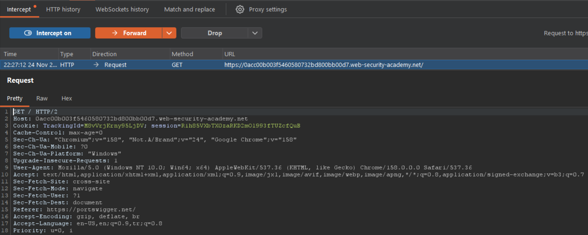

---
# ============================================================================
#  YAZI AYARLARI (front matter) — "---" çizgilerini SİLME.
#  NOT: Önizleme konteynerinin saati UTC; date satırını günün erken bir
#       saatine koy (ör. 20:00 +0300) yoksa "gelecek tarih" sayılıp yayınlanmaz.
# ============================================================================

title: "Blind SQL injection with time delays"   # Yazı başlığı (tırnak içinde)
description: "PortSwigger's time-delay SQL injection lab: when there's no error, no content change, and nothing reflected, the response time itself becomes the oracle — a single pg_sleep(10) proves code execution on PostgreSQL."   # Tek cümlelik özet; kartta ve Google'da görünür

date: 2026-11-24 20:00:00 +0300                  # Yayın tarihi (ileri tarih verirsen yazı yayınlanmaz)

categories: [Web Security]                       # _data/categories.yml içindeki alanlardan biri (renk buradan gelir)
tags: [portswigger, sql-injection, blind-sqli, time-based, postgresql, burp-suite, practitioner]   # Serbest etiketler (küçük harf, boşluksuz)

platform: PortSwigger Web Security Academy       # Üst bilgide "Platform" olarak görünür
difficulty: Practitioner                         # Apprentice / Practitioner / Expert (renkli seviye rozeti)

# --- Kapak görseli ---------------------------------------------------------
# Tüm SQL injection yazıları aynı kategori kapağını paylaşır.
image:
  path: /posts/images/sql-injection-cover.webp
  alt: "Blind SQL injection with time delays — lab cover"

# --- Güncelleme tarihi (İSTEĞE BAĞLI) --------------------------------------
# last_modified_at: 2026-11-24 20:00:00 +0300
---

<!-- ==========================================================================
     NASIL DÜZENLERİM? (bu blok ekranda GÖRÜNMEZ, sadece sana not)

     Köşeli parantezli [...] yerleri kendi cümlelerinle (İngilizce) değiştir.

     BAŞLIK:  ## / ###    METİN: **kalın** *italik* `kod`    LİSTE: "- " / "1. "
     LİNK:    [metin](https://adres)      TUŞ: <kbd>Ctrl</kbd> + <kbd>R</kbd>
     GÖRSEL:  
              - Yol /posts/images/... ile başlar; tırnaktaki metin alt açıklama olur
              - Dosya adlarına laba özel önek ver (sqli-time-...), yoksa çakışır
              - DİKKAT: görsel açıklamasında "|" (pipe) KULLANMA; tablo sanılır
     KOD:     ```sql ... ```  (diller: http, bash, sql, text)
     KUTULAR: satır altına {: .note} / {: .tip} / {: .warn}
========================================================================== -->

## Overview

Every lab so far has leaned on *some* observable difference. [Conditional responses](/blog/blind-sql-injection-conditional-responses/) gave us a "Welcome back" message; [conditional errors](/blog/blind-sql-injection-conditional-errors/) gave us a `500`; [visible errors](/blog/visible-error-based-sql-injection/) handed us the data in the error text. But what if the query runs completely silently — no content change, no error, nothing reflected, identical response every single time?

There's one channel left that the application can't hide: **how long the response takes.** If we can make the database *pause* on command, then time itself becomes the oracle. Send a payload that sleeps for 10 seconds; if the response comes back 10 seconds slower, our SQL ran.

This lab is the simplest possible version of that idea — we don't even extract anything. The goal is just to **prove** the time channel exists by forcing a measurable delay. This instance is **PostgreSQL**, whose sleep function is `pg_sleep()`.

> Only test on systems you own or are explicitly authorised to test, such as PortSwigger Web Security Academy labs.
{: .warn}

## The lab

**Goal:** The tracking cookie is vulnerable to blind SQL injection. The query runs asynchronously and has no effect on the response — no results, no error-based difference, no content change. Exploit the vulnerability to cause a **10-second delay**. That delay alone solves the lab.


## Finding the injection point

The vulnerable parameter is the `TrackingId` cookie on the home page request. Turn on **Proxy > Intercept** and catch the request so we can edit the cookie before it's sent:



## Exploitation — make the database sleep

Send the request to **Repeater** and append a PostgreSQL sleep to the cookie value. The `||` operator concatenates onto the existing string, `pg_sleep(10)` pauses for ten seconds, and `--` comments out the rest of the original query:

```sql
TrackingId=M8vVrjKrny95LjDV'||pg_sleep(10)--
```

Hit **Send** and watch the timer. The response returns `200 OK` exactly as before — but the status bar reports the round trip took **10,200 milliseconds**. Those ten seconds are ours: the database evaluated `pg_sleep(10)` because our injection ran:

 executed")

That delay is the entire solve. As soon as the server processes the sleeping query, the lab flips to **solved** — no login, no data extraction, just a demonstrated time channel.

{: .tip}
> The sleep function is dialect-specific, so a real engagement starts by fingerprinting the database. Rough equivalents of a 10-second delay:
> - **PostgreSQL** — `'||pg_sleep(10)--`
> - **Microsoft SQL Server** — `'; WAITFOR DELAY '0:0:10'--`
> - **MySQL** — `'-SLEEP(10)` (or `' AND SLEEP(10)--`)
> - **Oracle** — `'||dbms_pipe.receive_message(('a'),10)--`

## Why time is the last resort — and why it still works

Time-based injection is slow and noisy: every bit of real data costs seconds, not milliseconds, and parallel requests or network jitter can muddy the reading. It's the technique you reach for only when **nothing else leaks** — no boolean tell, no error, no reflected output.

But it's also nearly universal. A database that reveals *nothing* in its response still has to *do the work* you ask of it, and doing work takes time. That makes `pg_sleep` and friends a reliable confirmation that injected SQL executes, even against a perfectly silent endpoint. In the next lab we'll turn this blunt delay into a real oracle — wrapping the sleep in a `CASE` so it only fires when a condition is true, and reading out data one timed character at a time.

## Root cause

Same underlying flaw as every other injection: the cookie is concatenated straight into the query, so a `'` breaks out and the rest is parsed as SQL.

```sql
-- Vulnerable: the cookie value is pasted into the query
"SELECT * FROM tracking WHERE id = '" + trackingId + "'"
```

What makes *this* variant blind is that the query runs **asynchronously** and its result never touches the response — so there's no content, error, or status difference to observe. The one thing the developer can't suppress is execution time, and that's enough.

## Mitigation

- **Parameterized queries** are the fix — a bound cookie value is data, never executable SQL, so it can never call `pg_sleep`.

```sql
-- Safer: the value is bound, not concatenated
SELECT * FROM tracking WHERE id = ?
```

- **Query timeouts and monitoring.** A tracking lookup that suddenly takes 10 seconds is a strong signal; cap statement execution time and alert on anomalous durations.
- **Least privilege.** The tracking account shouldn't be able to call timing or system functions it has no legitimate use for.

## Key takeaways

- When a query is fully blind — no content, error, or reflection — **response time is the only remaining oracle**.
- `'||pg_sleep(10)--` forces a measurable delay on PostgreSQL; a ~10-second round trip proves the injected SQL executed.
- Sleep syntax is dialect-specific (`WAITFOR DELAY`, `SLEEP`, `dbms_pipe.receive_message`), so fingerprint the database first.
- This lab only *demonstrates* the channel; wrapping the sleep in a conditional turns it into a full data-extraction oracle — that's the next lab.
- Parameterized queries plus statement timeouts close it: bound data can't call a sleep function, and timeouts cap the damage if something slips through.
